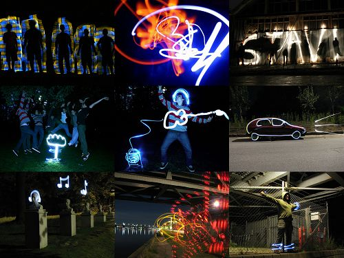

# awesome light graffiti pictures

Long Exposure pictures can get pretty awesome if you have the right ideas. One of the coolest ideas is to make sweet light graffiti with this camera option.  
  
The pix as below ,it's from Paulo, a 24 years old designer from Porto Alegre, Brazil. He work as a webdesigner since 2006, but websites and blogs have been a hobbie for me since 1999. At Abduzeedo, He try to bring only the hot stuff for you guys... Cheers!  
   
  
Related Content:   
[**\*\*LOVE light painting light writing**](http://www.youtube.com/watch?v=LqEUhMD7fhE)  
[**\*\*lighting effects inspiration**](http://abduzeedo.com/lighting-effects-inspiration)  
[**\*\*video week 6#**](http://abduzeedo.com/video-week-6)  
[**\*\*video week 7#**](http://abduzeedo.com/video-week-7)  
[**\*\*awesome light graffiti pictures**](http://abduzeedo.com/awesome-light-graffiti-pictures)

---

## 评论（3）

**Christina** · 2008-12-08

这也是有关光绘的，太神奇了！  
大家可以看看第一个视频。

**AM** · 2008-12-08

how can I beat them? \_

**Christina** · 2008-12-08

这么喜欢考试的人，一定能想出办法超越他们的作品的，呵呵~

