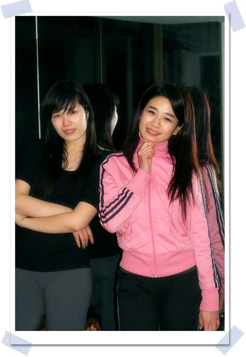
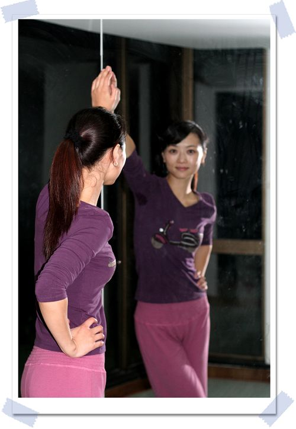

# salsa女子课

第一次上女子课，受益非浅！  
  
从学习salsa到现在，我的身体就象根棍子似的无法放松，永远是收紧的，以前学习舞蹈的习惯总是提着气，而salsa是需要将气沉下去，知道自己的问题在哪儿，可一时无法改变。今晚上看到自己微小的变化颇受鼓舞，除了多加练习之外，没有捷径可走。我要完全打散过去习舞方式，让自己的气沉下去，肩胛灵活起来。天呐，好难啊~  
  
接触salsa后的另一个疑问：为何女人们都要拼命减肥呢？应该让那些一心要减肥的女人去学salsa，她们就能体会到自己的身体是多么具有优势！圆润的体型在salsa律动中别提有多美，象我这样纤细的体型才是苦恼，动作的幅度必须要更夸张才能展现出salsa的美感。  
  
等待，等待明天早晨醒来后肌肉的酸痛，最好是肩胛那部分肌肉的酸痛。  
  
这是我们老师课前热身的视频：  
[**http://www.tudou.com/v/rccTeWvwHgs**](http://www.tudou.com/v/rccTeWvwHgs)   
  
女子们的身材都棒棒的！  
   
  
这么冷的天，居然出汗啦，可歌可泣！  

---

## 评论（8）

**令狐不放冲** · 2008-12-09

第二张对焦真的别有用心  
脖子很长  
size很大

**[joanna](http://yanmer.cn/blog/)** · 2008-12-10

瘦子不知胖子急呢:-)  
不能为了salsa特意增肥啵。我喜欢第二张，有点儿《幸福像花儿一样》里面孙俪的感觉

**叫兽** · 2008-12-10

挺有料的

**[新浪](http://www.sina.com)** · 2008-12-11

不错

**lilian** · 2008-12-11

好瘦！

**Michael** · 2008-12-11

LZ是很瘦的。  
不过身材不好，开心也行:)像我这样

**[samba](http://www.salsa-nanjing.com)** · 2008-12-12

原来这里的好多人都去我版里灌谁啦。。

**灰子** · 2008-12-12

哈哈，看来练salsa很投入，又是视频又是照片的。哇，腋下出这么多汗，小心着凉哦！

