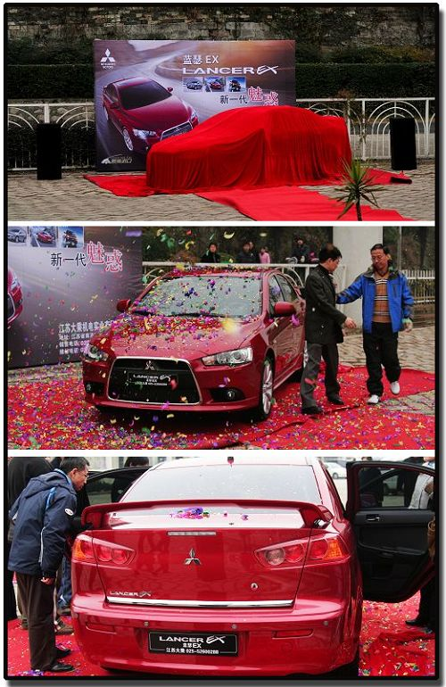

# “进口LANCER EX”新车发布会

今天下午在玄武湖的珍膳坊参加了“进口LANCER EX”新车发布会，该车有2.0、2.4排量，价格从21.5~28.5万不等，今天商家给第一位购买此车的女士赠送了三菱运动手表，让人眼馋哦。车的内部均为我喜欢的黑色，及黑色皮座椅，中控台和外形与三菱EVO基本一致，LANCER EX前引擎盖缺少EVO的进气口，总的来说进口的LANCER做工很是精致。所谓做工精致是相对[**明年该车型即将国产**](http://www.autohome.com.cn/news/200812/51310.html)的质量而言，新车发布会选明城墙做背景，提升了该活动的气质，下面是照片：  
  

---

## 评论（3）

**叫兽** · 2008-12-21

还是攒钱买EVO9或EVO10吧。甩尾机器

**Michael** · 2008-12-22

EVO 那可很强的哟.就是费点油

**绿恐龙** · 2008-12-23

还真满象的 小改装一下外形看不出来~

