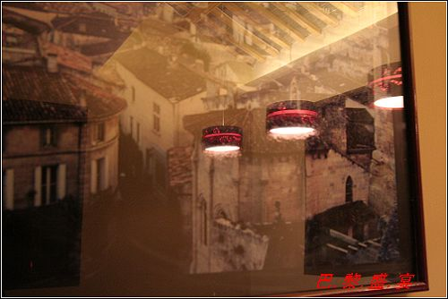
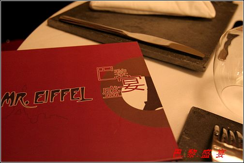
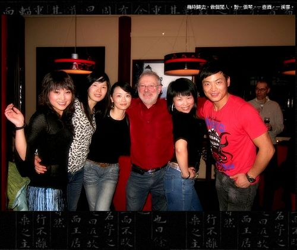

# 巴.黎.盛.宴

法国人Gildas跟随我们的老师学习salsa约两年，由于工作到期即将回国，他在[**巴黎盛宴西餐厅举办了一个冷餐会**](http://photo.lifetea.org/v/my+friends/800_001/20081220/) ，邀请一些人参加，我们排了一个女子三人舞作为告别礼物送给Gildas。我们排练了三次完成这个女子三人舞，还很粗糙，需要细细抠动作多加练习，群舞要做到整齐划一才好看，这是我们[**第四次排练的视频**](http://www.tudou.com/programs/view/KDr6Dtj-9KY/)，我自愿站在斜排队型的最后，那个穿白色上衣仓皇逃窜的女子就是我，哈哈哈哈哈哈哈~自己看了都会笑！舞蹈最后部分我总是慢，因为忘动作啦~~  
  
Gildas是一个跳舞时很会耍酷的老头儿，他的舞蹈阴阳顿挫，赋有表情。他总是悄无声息地进教室，然后悄无声息的离开。背着个小运动包，穿着休闲衣裤走进教室，鼻头冻得红红的，眼神总是若有所思...也许这是专属语言不通的异乡客的孤独，可是salsa可以拉近所有人的距离，让我们卸下压力，抛开烦恼和孤独，在大汗淋漓中热情地挥洒自我，那一刻，年龄、语言、身份、国界什么的统统都不是障碍！  
  
象他这样在国外生活、工作、学习的华人肯定也有不少，常常听到说融入当地社会很困难...何不尝试选择自己兴趣的一项参加当地的培训班？这样既能培养自己的兴趣爱好，又结交了一群志同道合的朋友，班上同学组织社交活动时也许会考虑到你哦？事实上这等于对所在地多了了解和融入的机会。  
  
   
   

---

## 评论（6）

**yellowstone** · 2008-12-22

都在美国生活十多年了，再融入又能怎么样，大家觉得还是中国人在一起玩的投入，好在美国华人很多，什么活动都有。

**itsmin** · 2008-12-22

对于移民来说，想要融入当地社会，主观努力当然很重要，不过客观环境却不会那么友好的。几代人华人移民的努力换来的不过是或大或小的China Town。

**Michael** · 2008-12-22

跳的相当的好！赞一个

**yellowstone** · 2008-12-22

你说的是老华人，近三十年来美国的华人都是各行各业的精英，大多数是医生，律师，教授，工程师，得到美国主流社会的认可完全不成问题，不过，对于第一代移民完全融入美国社会不是很容易，对于第二代移民几乎没有任何问题，华人作为少数民族已经很成功了。

**[dfgsd](http://12312)** · 2008-12-23

照片少点

**Haliyou** · 2008-12-25

舞蹈有些僵硬。还需要锻炼哦。：）

