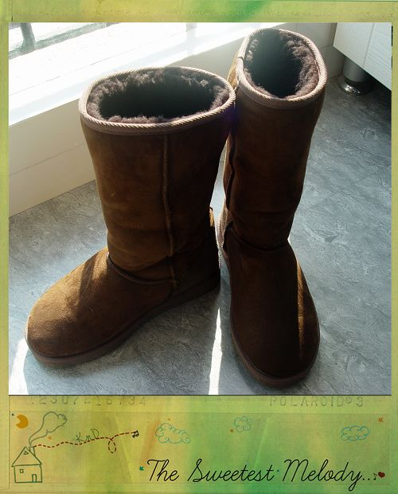
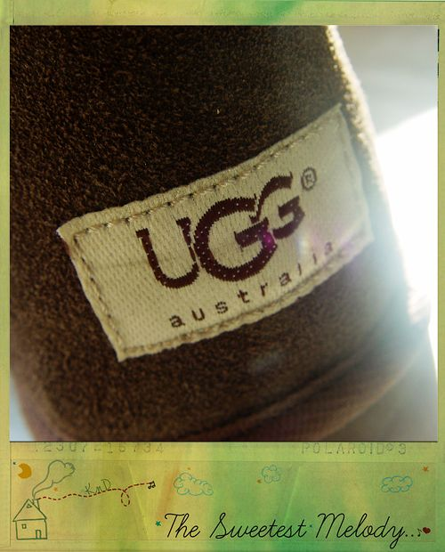
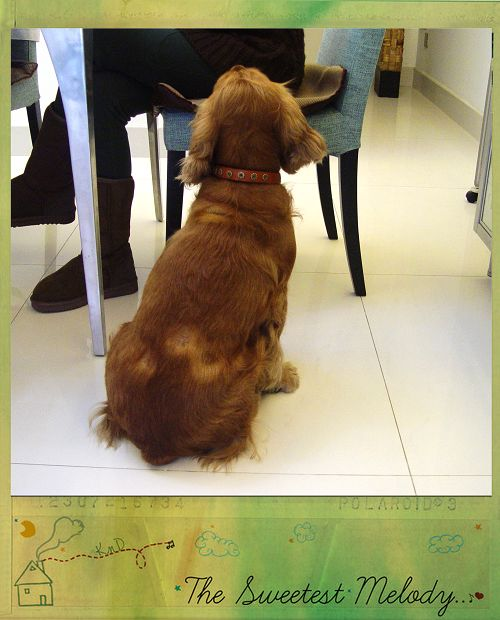

# The heart of life

这两周工作异常的忙碌，即使这样还是利用晚上的时间看了几部不错的电影：[**《Burn After Reading》（阅后即焚）**](http://ent.sina.com.cn/m/f/burnafter/index.html) ，[**《 Ghost Town 》（鬼镇）**](http://www.mtime.com/movie/75597/)， [**《Eagle Eye》（鹰眼）**](http://bk.pplive.com/movie/37915)，值得推荐。《Burn After Reading》（阅后即焚）可以说是又一部“蝴蝶效应”的剧情，里面很多大牌哦，有意思的是Brad Pitt完全改变以往帅哥角色，出演了一个脑子有点白，表情很搞笑的小人物“健身教练”。还想去电影院看看正在上映的国产电影《梅兰芳》，《叶问》和《非诚勿扰》，不过按照现在时间不够用的状况下，还是等D9版本的DVD出来买回家看比较省事。  
  
今天是平安夜，上午陆续收到很多朋友的短信，却没有外出的愿望，对节日没有感觉了，只对能休假在家感到高兴。不过倒很想晚上到街上拍些璀璨的霓虹灯，留下些08年最后的纪念。  
  
送上《Ghost Town 》里John Mayer演唱的一首歌曲： [**The heart of life.mp3**](http://www.nowok.net/Music/cc46590a3901ae6a.shtml)  
  
i hate to see you cry  
lying there in that position  
there's things you need to hear  
so turn off your tears and listen  
pain throws you heart to the ground  
love turns the whole thing around  
no, it won't all go the way, it should  
but i know the heart of life is good  
you know it's nothing new  
bad news never had good timing  
then the circle of your friends  
will defend the silver lining  
pain throws your heart to the ground  
love turns the whole thing around  
no, it won't all go the way, it should  
but i know the heart of life is good  
pain throws your heart to the ground  
love turns the whole thing around  
fear is a friend who's misunderstood  
but i know the heart of life is good  
i know it's good   
  
当满大街穿烂了UGG靴子之后，我也买了一双皮毛一体的UGG过冬用，这两天大幅度降温，最低温度在零下7度左右。于是穿了去上班，当我走在走廊里听见靴子撞击地面发生的声音，感觉象穿了双拖鞋~哈哈哈哈~不过真的好暖和！  
  
传闻美国的明星们超爱这款靴子，夏天穿了都不会出脚汗，听起来真有点悬，现在衣着搭配也开始MIX了，这么厚的靴子搭小体恤或者短西服也是可以的。记得90年代流行过澳洲伐木工人穿的大头鞋，有棕色、黄色 和黑色，满大街都是。实用的鞋子，有谁会错过呢？  
  
  
  
人类有信仰，宠物也是有信仰的。每当LUKE很虔诚地坐在餐桌下等待下食物的摸样，真觉得食物就是他的人生信仰，呵呵~LUKE的食欲好的惊人，他能在一分钟内吃完8只尹氏汤包......闻到肉香，舌头便不停的舔嘴巴，咽口水，超级谗猫！  

---

## 评论（6）

**itsmin** · 2008-12-24

平安夜在家感觉很是“祥和”:+)

**[光光](http://gaoguangguang.blogbus.com)** · 2008-12-24

啊，我有一双一模一样的这个靴子，颜色都一样。很暖和。我昨天还穿呢。今年买的，在美国是60美金，在国内呢？

**Harry Porter** · 2008-12-25

美腿 ：）

**Michael** · 2008-12-25

我也看过burn after reading…几周前，但现在却怎么也记不起来了。。。

**大姜炖去** · 2008-12-25

the heart of life  
我还无法体会到

**Haliyou** · 2008-12-26

Song sounds good.

