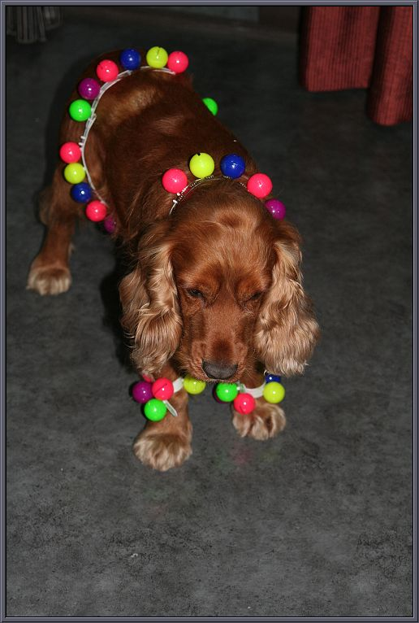
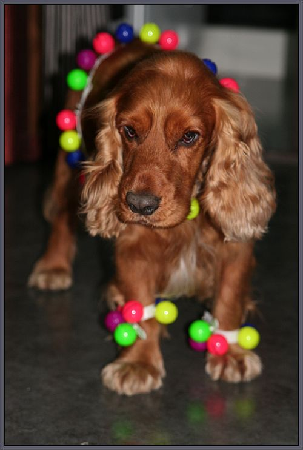
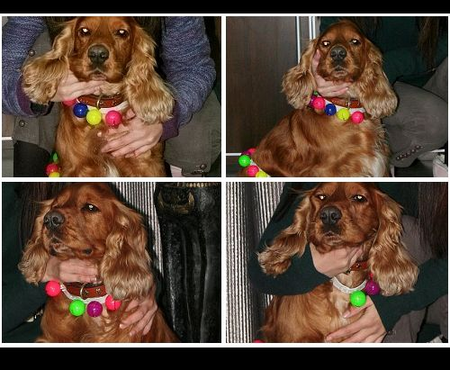
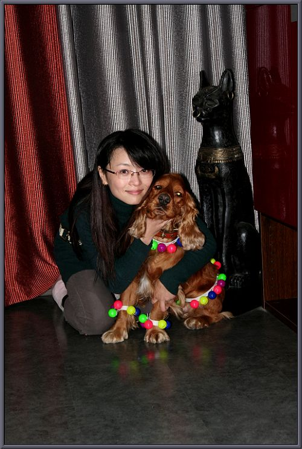

# 草裙舞.Luke

给Luke戴上彩色的铃铛，让它也体会一下圣诞节的余温！  
哇，这打扮很适合跳草裙舞哎~  
   
  
Luke戴上这些铃铛之后，走路变得异常缓慢，他不知道身上这些彩色的球球怎么会响呢~哈哈哈哈哈哈~  
  
  
我的小可爱~比刚来的时候帅多啦~  
   

---

## 评论（7）

**jiajialing** · 2008-12-27

我kao。。。好“变态”的，你……:)

**Christina** · 2008-12-27

靠你个头啊？！  
宠物也过圣诞节呀，哈哈哈哈哈哈~

**陈兴** · 2008-12-28

我觉得它不会喜欢这装扮  
当然我不是他

**Haliyou** · 2008-12-28

别人会以为你虐待动物的！ ：）

**[joanna](http://yanmer.cn/blog/)** · 2008-12-28

luke看起来好可怜的样子，我家狗小时候第一次戴铃铛，连虚虚都不敢，呆站着。  
也许宠物并不喜欢这样呢，我父母总说我是在折磨它。人类也许是为了满足自己的喜好，却往往还以为是对宠物好。这么多铃铛会不会对luke听力有影响？狗的听力都很灵敏的嘛@\_@

**Christina** · 2008-12-28

哈哈~你们多虑了，只是戴了一会儿而已，不会一直给他戴着的。

**itsmin** · 2008-12-28

戴铃铛?这对狗狗来说估计是超级恐怖的事了, 猫儿反应好象倒不大.

