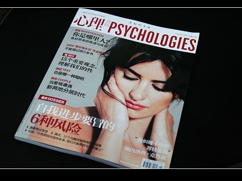

# 简单纯粹

  
  
上周拿到2009年订购的元月份的《心理月刊》，不用再跑去书摊买杂志了，每个月这本书就会自己躺在桌上等着我来翻阅。  
  
刚在jiajia的blog上看到一段话“......找到一个真正可以推心置腹的伴侣是多么不容易的事。但或许若是不那么诚实，反而才更长久......”这“不诚实”不仅仅是对伴侣，还应有对自己的“不诚实”。我常听到有人高谈阔论地说：“你看某某人，玩得凶呢，但人家该结婚就结婚，该生孩子就生孩子...”真不知道这些人究竟赞扬的是感情还是赤裸裸的交易？将伴侣当符号当为提倡？如果我们也能向自己隐瞒真实，那才可以“长久”，不是吗？这一切看起来似乎很复杂，如果有勇气还是可以梳理出一条简单的路可走。  
  
这期的《心理月刊》中有一篇《端上一只温暖的锅》的文章，提到“简单纯粹”，大致这样写的：“电影明星秦祥林年轻的时候，颇做过些不靠谱的事，比如好赌，比如为了林青霞不惜伤害当时的妻子萧芳芳。人到中年，他说，他几乎不回忆青春岁月，一回忆满是尴尬和难堪。秦祥林40岁息影，便不再抛头露面，说出这样的话，更看得出他是演艺圈里少有的拿得起放得下的人。年轻的时候谁没有做过几件荒唐事？又想起一段禅宗公案。云游的和尚走到一条河边，看见小媳妇不敢过河，说，来吧我背你。过得河去，放下小媳妇接着赶路，根本不再想这事儿。对自己年少轻狂，做了就做了，与其成为负担，不如向和尚学习，坦率地放下，忘却---前面还要赶路呢，前面有无限风光。”  
  
也许拿得起放得下，还真需要到达一定的年龄才能做到？一个二十几岁的人，是缺乏选择的勇气和是非的判断力，而女人过了三十岁，才算成熟起来，会抛弃复杂，追求简单纯粹的生活。如文中所说“用简单功能的手机，看书要捧纸质印刷品，拍照用超薄数码相机，家用电器开关功能不超过3项，听没有歌词的中外古典音乐......”对此，我很有共鸣，也是现在越来越宅的主要原因。作者苏眉说有次去买唱片，店老板说：“精神和心智完善、发展到一定高度，人就会追求形而上，所以年纪大了会听古典乐；它们没有使用语言文学，因为文字已经很难表达你这个年龄的情感。人生这一天天，找来找去，最后发现要找的是简单纯粹。”

---

## 评论（6）

**bshawk** · 2008-12-28

首次来访，你的blog写得很不错！  
只是人在红尘中，抛弃复杂，最求简单纯粹，有时候谈何容易，这需要相当的心境才能做到吧！

**okdata** · 2008-12-29

成熟与年龄相关，但更与阅历相连  
斜阳下的平静或许是老蓝布的旗帜  
简化，纯粹

**[samba](http://www.salsa-nanjing.com)** · 2008-12-29

我推荐个chris botti《italia》专集。  
修炼心境必听。  
有人帮我算下我心理年龄？

**michelle** · 2008-12-29

absolutely right！懵懂不安时复杂，透彻沉稳时简单。

**itsmin** · 2008-12-29

我觉得“拿得起放得下”也不是一定跟年龄有关系的。而且，在每个年龄阶段都有不同的选择与挑战。关键是要和自己保持对话，倾听内心深处的声音。

**[清雅聊斋](http://blog.sina.com.cn/chinatea)** · 2008-12-30

轻轻的来过

