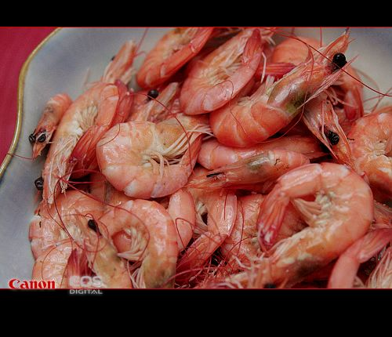
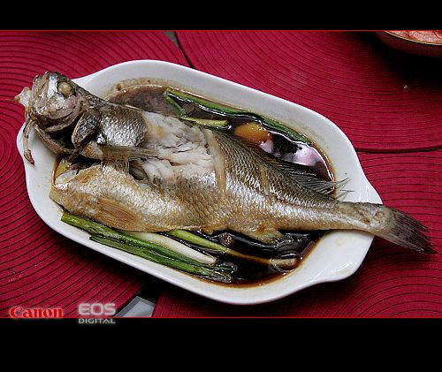

# 昨晚做的菜。

盐水对虾，很方便做的菜。在水中放入葱、姜、料酒、盐、糖，倒入虾，煮沸，想吃嫩的煮的时间不要太长就可以出锅。  
   
  
鱼用盐、糖、味精、料酒、蒸鱼豆豉油抹一遍，浸泡15分钟左右，放入微波炉，蒸汽模式下加热4到5分钟就可以吃了。  

---

## 评论（6）

**大姜炖去** · 2008-12-31

有没有做过醉虾  
我觉得那个是最嫩的  
\_

**绿恐龙** · 2008-12-31

鱼蒸的一般 洗干净在鱼身上划几道 先撒调料蒸一下 然后10分钟后把水逼掉，身上洒满葱姜丝，然后用蒸鱼豉油撒上，再蒸5分钟 Ok~

**Christina** · 2008-12-31

楼上这个蒸鱼的程序不错哇，比较合理~  
醉虾不拒绝，但是卫生是问题，河水污染~

**令狐不放冲** · 2008-12-31

很厉害，轻描淡写几分钟，看着很有食欲

**itsmin** · 2008-12-31

楼主的做菜的手势有点像粤菜亚.

**Michael** · 2009-01-05

在最左边的那只小虾太可怜了,被挤在那里…

