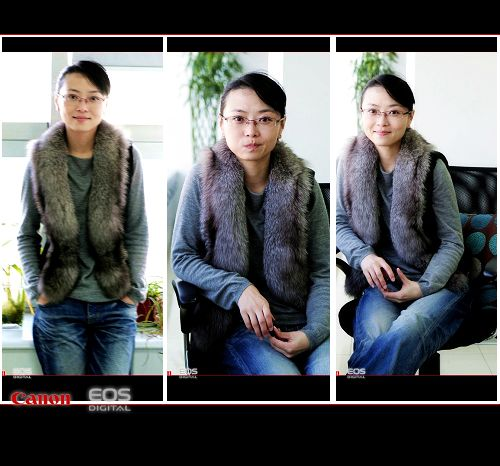

# 2008年最后一天

记得去年最后一天，我也穿了件背心，羽绒的，很短，外面是毛线织的面料，也是灰色，胸前有个黑色的蝴蝶结。人们总是给这些平凡的日子赋予一些意义，以我目前的心态每一天都是一个样儿，已经不需要什么特别的意义了。  
  
2008年的最后一天，上了一整天的班，屁股坐下来就开始忙，到了下午就希望别再下新定单了，让我好好歇歇吧，拿出特地带着的相机，在办公室里拍了几张自己，留作纪念。  
  
晚上在家吃过饭，被朋友叫去烧香，很夸张，居然有15辆车。进了寺庙，老远就看到SALSA老师的高跟鞋，寻过去却不见了踪影。于是站在寒风中看那些虔诚或非虔诚的人在呼呼的寒风中点香烛，烧高香。幸好穿了滑雪裤、厚靴子和羽绒服，戴着手套，基本没感觉到冷。烟花开始放了，钟也敲响了，2009年到了。新年，我还是我，不以别人的标准为标准，梳理好自己的生活，就是对关心我的人最好的回报。新年希望能延续这种平和、快乐和健康。  

---

## 评论（11）

**大姜炖去** · 2008-12-31

新年快乐

**陈兴** · 2008-12-31

衣服很漂亮

**Edward** · 2009-01-01

09年第一天祝你越来越漂亮！:)

**[目标](http://wuzhi.blogcn.com/index.shtml)** · 2009-01-01

happy new year to you!

**Annie** · 2009-01-01

Happy New Year!

**雷森** · 2009-01-01

2009，好久没来了，看到新的中国茶了，大家新年新吉运~

**清雅聊斋** · 2009-01-01

新年快乐

**Christina** · 2009-01-01

大家新年快乐！

**bshawk** · 2009-01-01

Happy New Year!

**[samba](http://www.salsa-nanjing.com)** · 2009-01-02

哈。那天我很忙。  
下午温泉，晚上宝莱纳，又11点从南京出发去宝华山，回来又鹿港小镇吃消夜。新年的膘就是这么养出来的。这里朋友新年好，GERI09年SALSA节节高！

**Dhyana** · 2009-01-03

Happy new year! Be true, be real!:)

