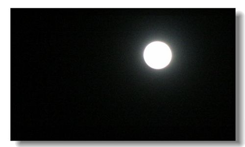
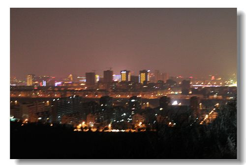
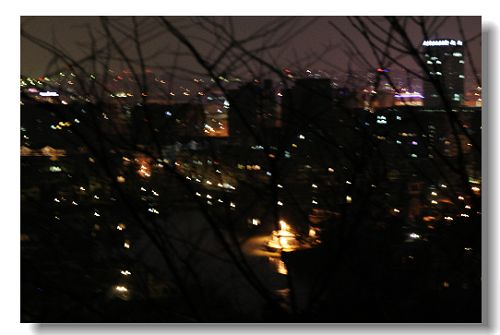

# 大月亮

1月10日晚，月亮比平时“大”16%，月亮看起来又大又圆又亮。据说，这是12年里月亮离地球最近的一天。当天晚上天气非常寒冷，穿上羽绒服和雪地靴开车到山顶看月亮。  
   
   

---

## 评论（3）

**Michael** · 2009-01-14

铁手也有抖的时候:)

**Clara** · 2009-01-14

谢谢！不能确认是走哪个角度的，亮亮的地方是玄武湖反光吗？前湖一带07年回去的时候改造得很雅致呢。

**Christina** · 2009-01-16

有两个三角架呢！

