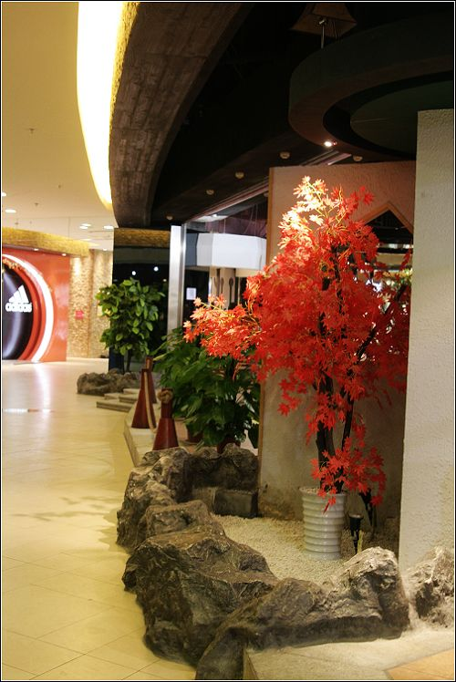
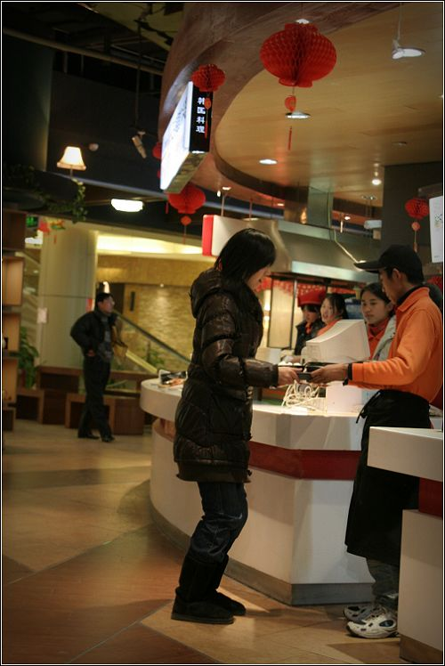
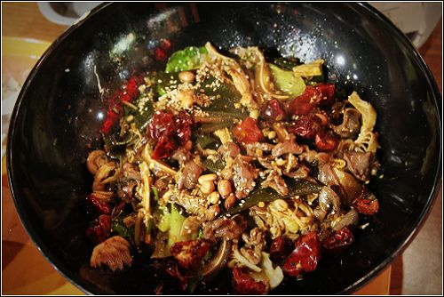
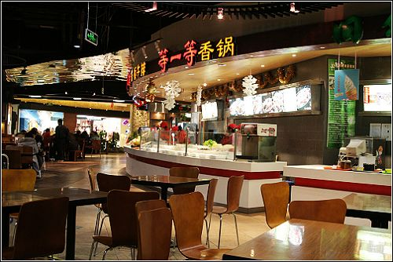

# 等一等香锅

上一周每天晚饭后都会看一部电影，渐渐又开始逛大街啦，喜欢上“等一等香锅”的麻、辣、香，虽然也只是吃了一次而已，想到那种口味就想流口水。这家店做生意很聪明，不是按一大碗多少钱计价，而是客人在店家展示的生菜里挑选自己想吃的内容，按重量称，我和nana吃的这碗要79元，因为我爱吃肉，点的荤菜比较多，最后两个人还是没有吃完，好可惜啊！  
   
   
   

---

## 评论（10）

**Sherry** · 2009-01-14

推荐我家附近的“香锅里辣”，非常好吃，朋友经常在那里聚会。

**[Stella](http://1)** · 2009-01-14

那么远，却又这以近。原来我们今天去过同一个地方。。。

**[Stella](http://1)** · 2009-01-14

那么远，却又这么近。原来我们今天去过同一个地方。。。

**农妇** · 2009-01-15

好像里面有牛百叶和猪耳朵啊？！  
我大概这几天做梦要梦吃猪耳朵了……

**Michael** · 2009-01-15

现在流行吃干锅

**Christina** · 2009-01-15

对的，有猪耳朵、毛肚、鸭胗、牛肉，金针菇、生菜。喜欢吃毛肚和猪耳朵，这种既有脆骨又有皮的荤菜。

**sususu** · 2009-01-15

一看就是是水游城的等一等香锅，呵呵，吃过好几次了。我喜欢点脆皮豆腐、牛肉、生菜、平菇

**[Jonathan](http://www.douban.com/people/1825883/)** · 2009-01-15

哈，看到就觉得不错

**大姜炖去** · 2009-01-16

爱吃肉，还这么瘦  
看来还是每天吃的不多  
不过做肉食太费时了

**Enriquesun** · 2009-01-18

哇 好香哦  
好久没来了  
出院第一天先来看看   
顺祝春节快乐

