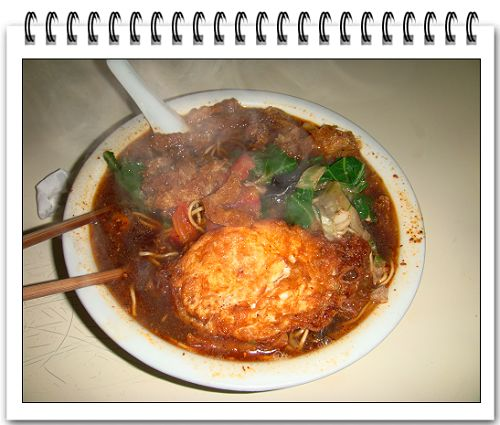
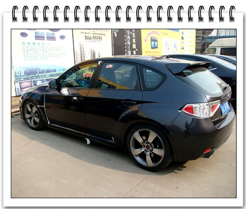
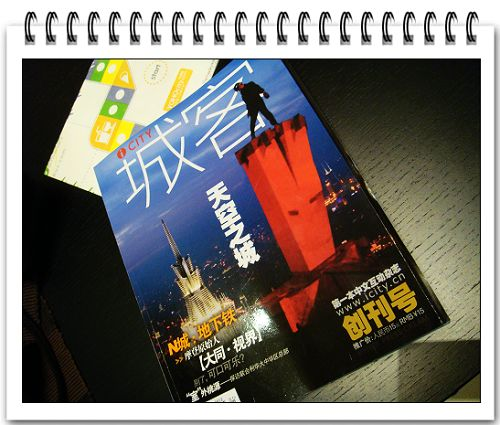
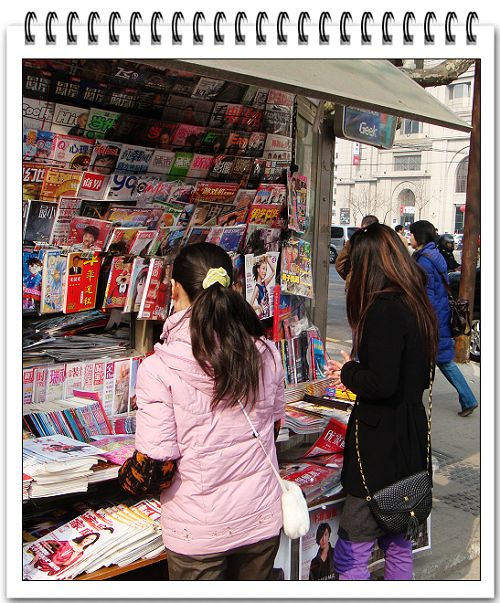
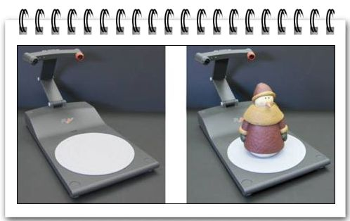

# 轻松度周末

周末想吃康记的大碗面，尤其喜欢这家的三鲜皮肚面。小小的店面，开了好多年，每天估计能卖出去几百碗，这碗面加了一个鸡蛋，12元。每次去客人都很多，只是国内的面馆经营意识落后，店面形象邋遢，如果能象“味千拉面”一样树立好形象，多开些连锁不是问题。想起新街口的“芳婆”，卖些肉粽子、茶叶蛋、赤豆元宵之类的食品，口味不错，客人也多，也是形象差。  
  
记得有一次去吃面，一个胳膊上满是刺青、头发板寸的中年男人坐在帐台后面问：“想吃什么？”  
我一本正经地说：“有什么？”  
“你想要什么，都有。”  
“月亮有吗？”  
“有啊，马上给你捞。”  
  
  
还有一周就要过年了，把车送去清洗内饰，米色的车顶上一层灰。出乎意料的是店家真的把车顶的灰尘清理掉了，而且象新的一样。在院子里遇到这辆STI，低调的外型，超猛的动力，是不是这就是所谓的“扮猪吃老虎”？让停在它旁边的Audi、Honda黯然失色，这款车百万以内无敌，这代EVO也比不过。  
  
  
上周收到[**横戈**](http://hengge.blogbus.com/)寄来的2009年首刊的 [**《城客》**](http://www.icity.cn/)，香港也同步发行了。横戈的创刊词这样写的：两年前，我说想做一本杂志，引来无数的人跟我PK，劝我不要去做杂志。而今天，这本叫做《城客》的杂志，终于创刊了。  
  
劝我不要做杂志的，要么是好朋友，要么就是“业内人士”，大都说杂志是烧钱的东西，平面媒体一天不如一天，我守着“新媒体”却要蹚“旧媒体”的浑水，实在不是明智之选；还有的稍稍积极一点说，杂志要想赚钱，至少得熬个三、四年，前两年就别想赚钱的事儿，劝我把期望值放低点，说到底做杂志是个吃力不讨好的差事。  
  
可我知道的是，中国，甚至全世界，真正“好”的杂志并不多……[**更多内容**](http://www.icity.cn/article_3.html)  
  
一个免费的blog网站公司，创办杂志，是“肥水不流外人田”。整个网站上有那么多优秀的写手，摄影师和潮人，有许许多多生活在世界各地的bloggers，我在blogbus上就有两个喜欢阅读的女性blog，一个在纽约，一个在英国......忽然想到一首歌的歌词“在很久很久以前，你离开我去远空翱翔。外面的世界很精彩，外面的世界很无奈，当你觉得外面的世界很精彩，我会在这里衷心的祝福你......”blogbus将可利用资源集中起来展示，让人足不出户就能领略到他乡城市的点点滴滴，省去网虫们的查找、搜索，捧着《城客》就好象乘坐大巴士环球旅行一样有趣~  
   
  
虽然今年定购了三本杂志，但还是想买些时尚的杂志回家解谗。卖杂志的是个中学生摸样的小女孩，手脚生疏，讲了几遍才有反应，态度倒是随和的，一抬头亭子里面还有两个学生妹一同在帮忙，现在是寒假时间，小小年纪就开始帮大人分担生活压力了。家庭经济稍微宽裕的，估计这时候都在各个补习班啃书本呢~做孩子也不快乐，长大了能快乐吗？  
   
  
老天啊，超小台扫描仪！不但网拍将面临3D革命，连开箱文都不需要再上下左右四面各来一张啦！  

---

## 评论（9）

**令狐呆** · 2009-01-20

我是来拜一下上头紫色裤子的潮人学妹的，我报料那是楼主，藕麦糕~

**淡蓝色** · 2009-01-20

楼主背的这个包包很好看！

**sususu** · 2009-01-20

LZ有一位很不错的摄影师呢，能记下生活的各个瞬间。当然LZ本身也是一位很有品味的摄影者，呵呵。

对了，很想知道你洗车内饰的店在哪，我就没遇到好一点的洗车店

**Christina** · 2009-01-20

洗车店是“新奇特”啊！  
裙子是半截裙，很紧哦：）

**Luckylulu** · 2009-01-20

这辆STI好像是我一个朋友的，我把这篇网页粘给他看，他也不确定是不是就是他的车，不过他说非常感动，很有遇到知音的感觉。不知道CHRISTINA有没有拍清楚拍照，他刚上的牌，中间有数字03

**Christina** · 2009-01-21

这辆STI在店里做漆的，拍了车尾的车牌，非常清楚呀，好象在该车的BBS版上看到过这个车牌，是买了不久，非常确定以及一切肯定、车牌里的确有数字3！回家我再看看车牌的照片答复你哦~

44万多的STI要停卖了，只卖49万多的那款，商家真会做生意！不过08款STI的外型我不是特别喜欢，太象行旅车了：P

**Christina** · 2009-01-21

跟你朋友说什么时候让偶试驾一下，江湖流传这车如何如何猛，偶们也只能看看官方数据，就是一个数字上的概念，从来没有体验过，4S店连样车都没有，呵呵~不过我开MT的车比较生疏哇：P

**[薇安](http://www.bulaoge.com/?vivianxu)** · 2009-02-02

城客哪里买的到？

**Jasonchen** · 2009-12-23

楼主,喜欢最后图片中的扫描仪有没有更详细的介绍?谢谢了

