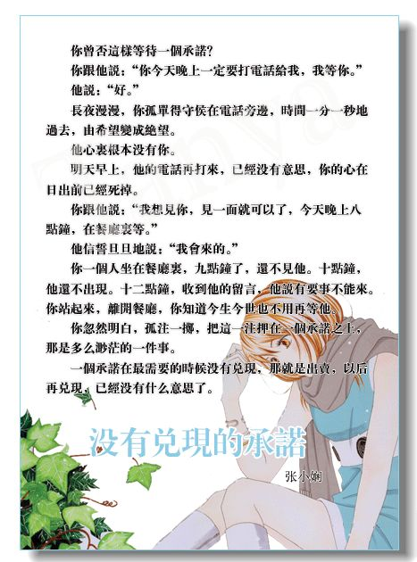

# 没有兑现的承诺

这则小文让我想起以前很多那些没有兑现的承诺，并不是有关人生、命运的承诺，而是些非常小非常小，小到芝麻那么点儿的承诺，这些小芝麻堆积成一个大大的失望，乃至绝望。此后，不要听对方说什么，而是逐渐学会观察对方究竟做了什么。  
  

---

## 评论（2）

**itsmin** · 2009-02-03

这个世界上向来就不缺乏善于承诺又**不善于履行诺言的人**，有着优良道德品质的人越来越难碰到。还有谁在送信给加西亚吗？

**[yanglei](http://www.yanglei.name/blog)** · 2009-02-03

这种生活中的小事，都能体现出做人的本质。

