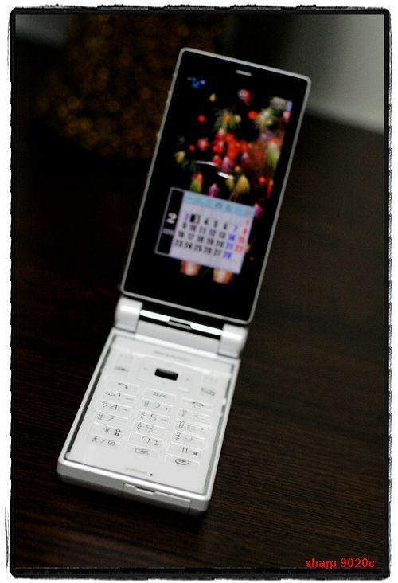
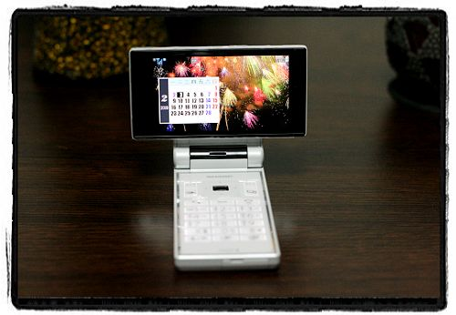
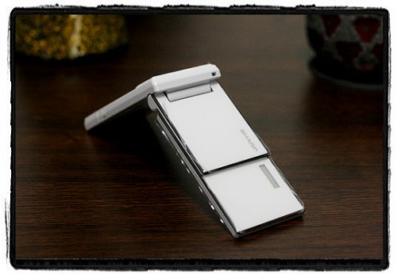
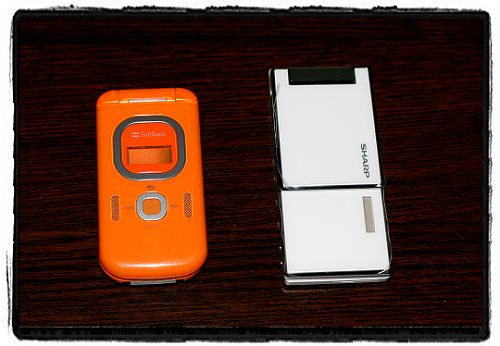

# 新年.礼物

去年过年给自己买块手表；  
今年......给自己换了个新手机作为新年礼物。  
   
   
   

---

## 评论（6）

**Enriquesun** · 2009-02-03

夏普的？
方方正正的，女士用感觉不太合适哦  
红壳子的是哪个？

**itsmin** · 2009-02-04

没用过Sharp的手机。。。看起来挺酷的。

**Christina** · 2009-02-04

橘红色的是之前 用的手机啊，新旧交替啦~  
也许我的内心不那么女性化？还是喜欢稍微大点的手机，太小的手机没有手感。这款9020C的许多小功能很酷的，用用就知道了~SHARP的屏幕超赞，可以扫描名片和条码，放大、缩小屏幕内容只要左右或前后摇晃一下手机即可......

**[69](http://bulaoge.com/?jincanzh)** · 2009-02-05

sharp…  
nb!

特别是屏幕，是出了名的nb

**Catherine** · 2009-02-06

偶也想买这个的,等了很久的行货简体中文版……..

**Christina** · 2009-02-06

我买的就是行货。

