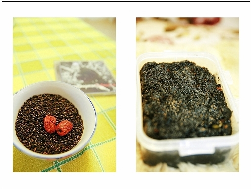
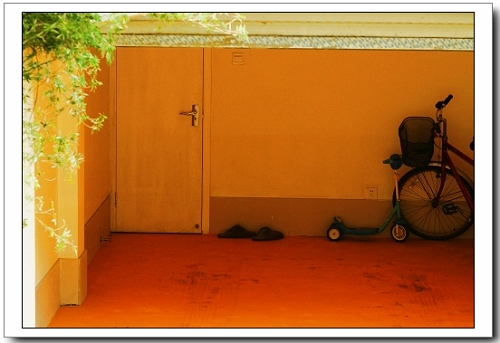

# 两个人的相机日志：立春

今天，薇安和我开始一起用相机记录中午，晚上交换相片，然后对彼此的相片作一些猜想和评语，第一张薇安拍摄，第二张是我的。这次体验的开始，[**是这样的**](http://lifetea.org/article/2142/#comment)。  
  
[**薇安**](http://bulaoge.com/topic.blg?dmn=vivianxu&tid=963332#Content)：冬去春来，开始进补，黑色食品可是好东西。黑米红枣粥和汤姑娘送来的固元膏。比春风更暖心。  
  
Christina：黑米造就窈窕。  
薇安，这个未曾谋面的女子......  
如何用纤纤十指调制出诱人的香气？  
   
  
Christina：立春的中午，遛狗。  
路过一间敞开的车库，暖黄的地面，暖到人心里去了。  
  
薇安：春天走进南京的每一个角落，今天是立春。气温12°。她的午后静悄悄。  

---

## 评论（11）

**zyz** · 2009-02-04

NICE PICS

**[薇安](http://www.bulaoge.com/?vivianxu)** · 2009-02-04

woo~第一天真不容易。希望会越来越好

**绿恐龙** · 2009-02-05

就是把2个都有着频繁记录生活的2个人 每天记录约定时间段发生的事情 让我想到了迷失里面 那些被困在岛上的人被人用监视器记录每天的生活 感觉像一种偷窥 想彼此了解每天固定时间段的生活 而这种记录又在中午 便是忙里偷闲时彼此的生活 恩。。我想知道每天2个人上床 或者洗澡时候的记录。。

**Christina** · 2009-02-05

倒！那是全时记录，这里是瞬间的记录。  
如果你那么渴望完全可以开始记录自己的晚上啊；）

**mandy** · 2009-02-05

喜欢第二张~~

**灰子** · 2009-02-05

推荐三个网站，希望对你有用：  
http://www.d-n-d-n.com  
http://renyue.ofpix.com  
http://nabo.blogbus.com

**灰子** · 2009-02-05

1、摄影是一种减法艺术，需要培养一种善于提炼和概括的思维及独特和多元的眼光。通过观察和感悟，把自己感受到的情景和情绪从纷繁复杂的事物中抽离出来。  
2、画面之所以干净和唯美，是因为首先拍摄者需要具备美的理解；其次通过构图上的取舍、光影上的对比、景深上的虚实等使画面干净或者达到自己的意愿。  
3、很多喜欢摄影的人不懂得如何通过摄影表现自己的情绪、如何表现自己的生活、如何关注身边的亲密朋友、以及对社会的看法和理解甚至批判。而是仅把目光投向花花草草、山山水水以及漂亮的美美。如你能注重记录自己的生活，并能把自己的生活记录的纯粹透彻，再加入自己的点儿小情绪，那已经是非常好的照片了。这个时候构图、光影、景深也显得不那么重要了。  
4、摄影或者拍照片其实是很个人的东西。是发现自己、认识自己；自己看外界，自己过生活的真实记录。像戴安娜·阿勃丝、南·戈尔丁、萨丽·曼、辛迪·舍曼等这些享誉全球的女摄影家也都把目光积聚于此。  
5、所以，摄影能否愉悦自己、能否被自己喜欢就足够了。若要再上升一个层次，像尤金·史密斯，塞巴斯提奥·萨尔加多，约瑟夫·寇德卡那样，摄影就会很辛苦，需要付出很多代价。  
呵呵，以上是对你留言的答复，纯粹是自己的浅显的理解，望能参考。

**Rachel** · 2009-02-05

生活随笔，虽然没有太多的文字，却更多了几分吸引。等着看好片啦！

**[joanna](http://yanmer.cn/blog)** · 2009-02-05

支持这种有意思的活动。来个女人帮纪事？想来挺有趣的

**寸碧点点** · 2009-02-05

第一张做的是固原膏吧？！前几天自己也做了一次，吃了很有效果：）

**[少爷](http://jennyshaoye.blogbus.com/)** · 2009-02-08

每天都要来看看

