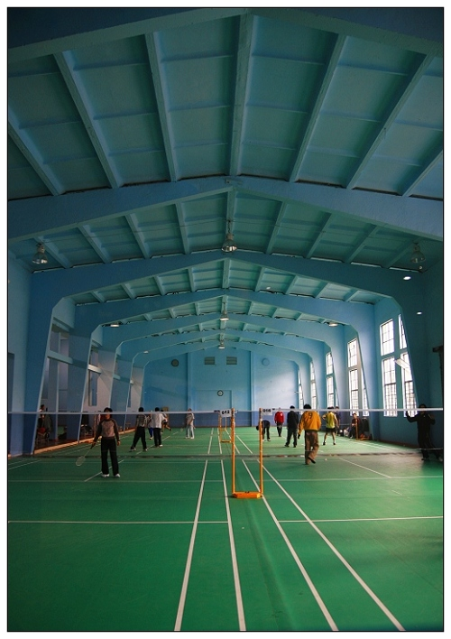
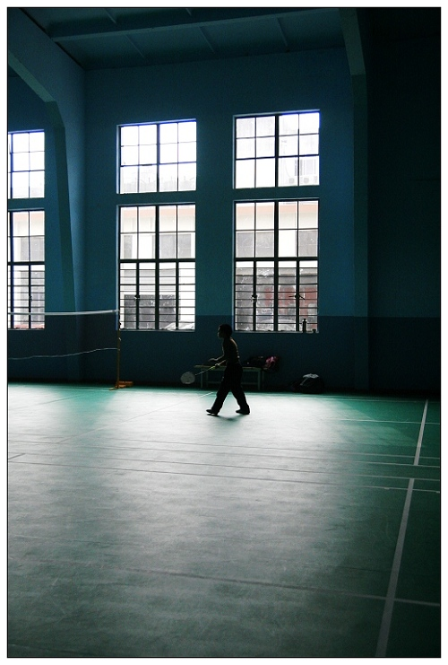
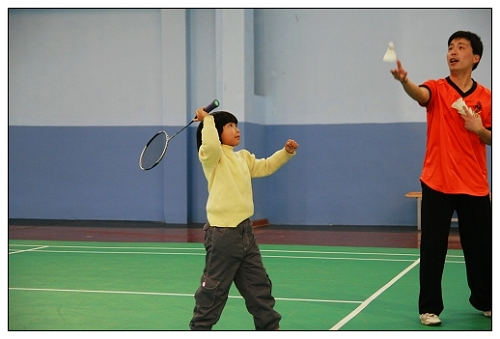
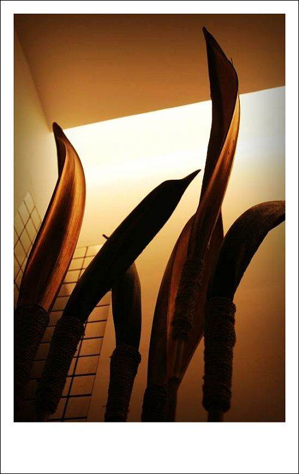
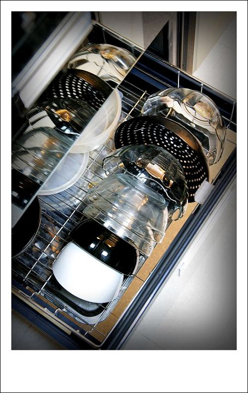
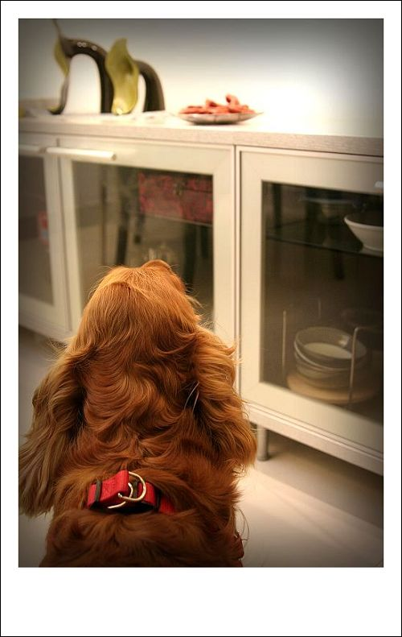

# 两个人的相机日志：2月8日

[**薇安**](http://bulaoge.com/topic.blg?dmn=vivianxu&tid=967737#Comment)：羽球运动得从小练起！我们都是业余爱好者而已。坚持哦。我喜欢这个用旧厂房改的羽馆，火车厢式的房顶和蓝绿搭调，最主要是窗外射进的阳光，让人恍惚。  
  
Christina：打羽毛球可比打网球出汗多哦，这个天小心着凉。今天你拍的照片我都喜欢。  
   
   
   
  
Christina：周末宅在家里，默默地生活，追随自己内心的渴望。这种沉浸能让我体会到一种全身心的依赖，我是不是真的稳定下来了？  
  
薇安：细致用心的女主人总能以漂亮的餐厅布置令人垂涎。从细节见品味。  
   
   

---

## 评论（10）

**大姜炖去** · 2009-02-08

我在想在羽毛球馆如果地上躺着拍，这个屋顶比较有意思

**Christina** · 2009-02-08

春节放假了呀！

**smilyEve** · 2009-02-09

Luke那张。

Luke正面表情想象ing~~~

**itsmin** · 2009-02-09

人生的某个阶段，总会有相对稳定的时候。所以，没有问号，只有肯定号。

**Christina** · 2009-02-09

Luke坐着凝视桌上面那盘鸭掌~不停的舔嘴巴。

**Google阅读器** · 2009-02-09

最后一张很有故事

**shao ye** · 2009-02-09

Does Luke need trimmed now?

**灰子** · 2009-02-09

很喜欢前面两张和最后一张哦～

**Christina** · 2009-02-09

国内没有给狗理发的，要么推子推一下：D脚上的毛会经常修的！

**[少爷](http://jennyshaoye.blogbus.com/)** · 2009-02-10

如果把它头顶到耳朵上部的毛修短些，它会更英俊喔。虽然它已经非常英俊了。嘿嘿。

