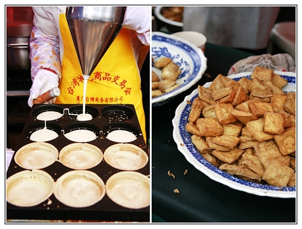
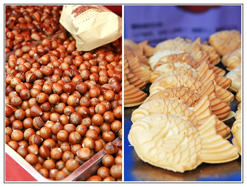
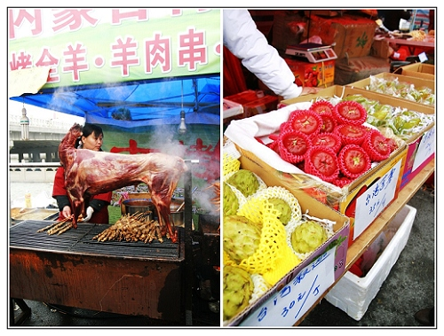
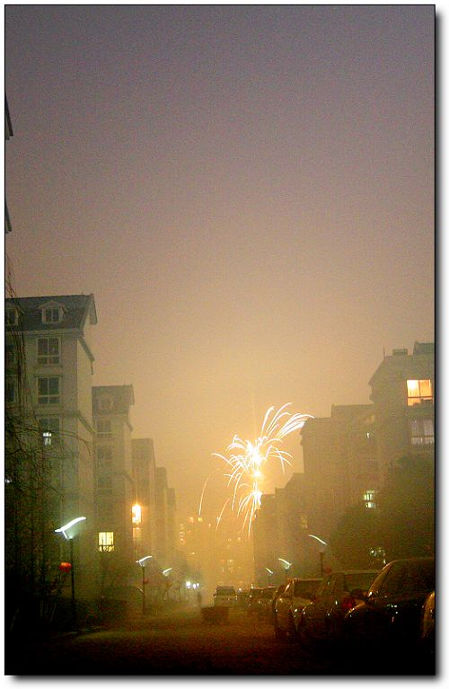

# 两个人的相机日志：2月9日

[**薇安**](http://bulaoge.com/topic.blg?dmn=vivianxu&tid=969064#Comment)：我这么有兴致，中午特意打车去看那个元宵的台湾小吃展。风很大，可我还是打包了好几样回来吃。贵虽贵点，也要活得有滋有味嘛。  
  
Christina：这么多好吃的哇，怎么会是台湾小吃呢？明明就是俺们大陆的小吃嘛：）那个鱼是什么食品啊？  
   
   
   
  
  
Christina：元宵节哦，外面几个小时连绵不断的鞭炮声向这个春节做着疯狂的告别。回到家，LUKE就开始粘人了，我就半个屁股坐在椅子上，要是跌地下，非扭断这小子的脖子不可！刚才LUKE被一阵急促的鞭炮声惊醒，掉地上了，朝着鞭炮声的方向怒吼~  
  
薇安：元宵的烟花在耳边彻响了整晚。原来我们还是很传统的。没想到LUKE小伙这么粘人啊，下次要给我来个稍息立正站好。  
   
   

---

## 评论（8）

**itsmin** · 2009-02-10

和茶有相同的问题…那个是鱼形饼干?

**Martin** · 2009-02-10

那个鱼是鲷鱼烧，源自日本

**[少爷](http://jennyshaoye.blogbus.com/)** · 2009-02-10

那个30块一个, 和35块一个的,是什么东东啊?

**Christina** · 2009-02-10

以前台湾来的一个宠物师倒是给我家妞妞修过，可是我更喜欢毛绒绒的狗狗：D

**lilian** · 2009-02-10

狗狗的毛发被打理得油光锃亮的，可见主人的心思。。。

**Michael** · 2009-02-10

狗的毛在晚上看起来很好. 有对比

**[薇安](http://www.bulaoge.com/?vivianxu)** · 2009-02-10

那个30块一个, 和35块一个的,是什么东东啊?  
都是台湾水果，一个是莲雾，一个是释迦

**mandy** · 2009-02-11

在厦门台湾水果批发点吃过莲雾和释迦，非常好吃，特别是释迦，有小皮球那么大，很甜，冰镇之后口感像冰激凌。

