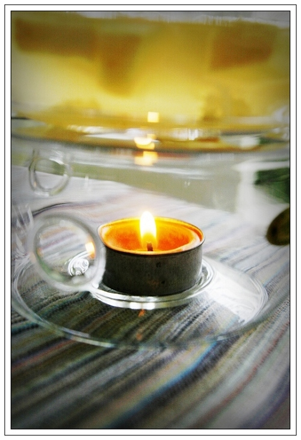
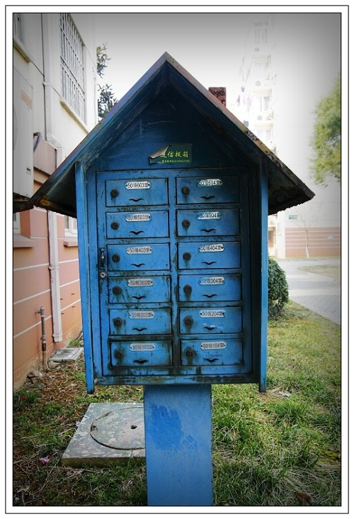
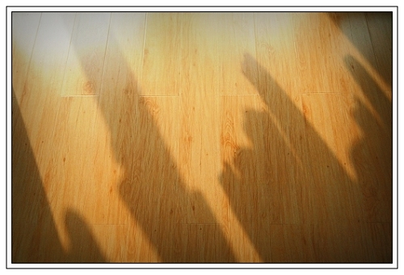
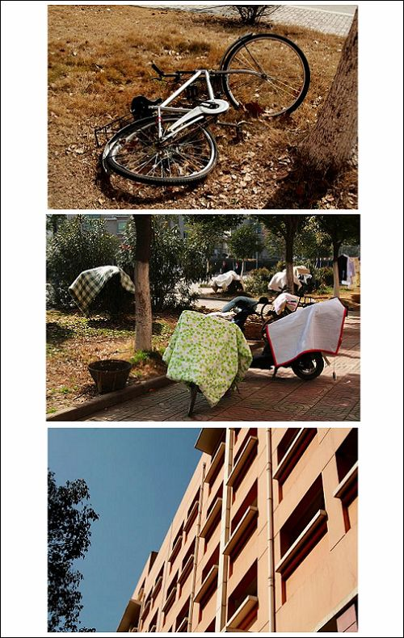
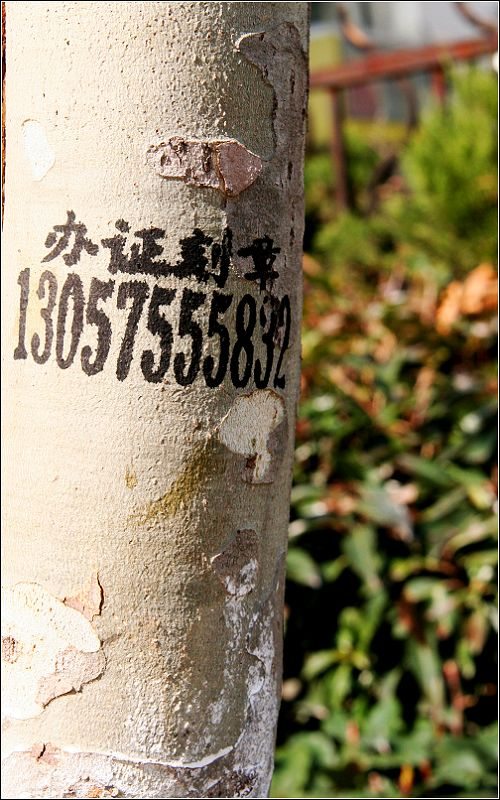
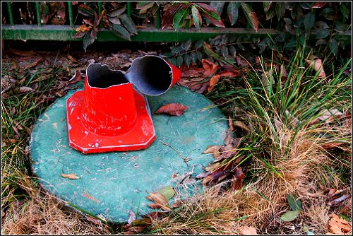

# 两个人的相机日志：2月10日

[**薇安**](http://bulaoge.com/topic.blg?dmn=vivianxu&tid=970150#Comment)：斜进屋子的阳光，还有午后煮的一壶柚子茶。是我最后记录的幸福。  
而信箱筒已经在我们生活中的比重越来越小。  
  
Christina：咿！我们不约而同地都拍了阳光~好象我从来没打开过信箱，虽然看到里面插着信件。遇到你我才知道什么是真正的追求完美。  
   
   
   
  
Christina：大太阳哦，气温一下回暖到15度了，据说明后两天会到20度！阳光明媚，心情也明媚！  
  
薇安：太阳果然暖洋洋，温度直升。利用好这个大好春日的最好办法就是晒被子吧。。。  
老百姓的小幸福。  
   
  
   
  

---

## 评论（4）

**itsmin** · 2009-02-11

这一组照片挺温暖的。。。一切看起来都很不错的样子。

**Christina** · 2009-02-11

谢谢支持哦！昨天是最后一天和VIVI的相机日志，今天开始和另一个现实中的朋友继续。

**[pp](http://www.truewater.net)** · 2009-02-11

感觉到春天了

**ikhe** · 2009-02-11

我喜欢第二张和最后一张，呵呵

