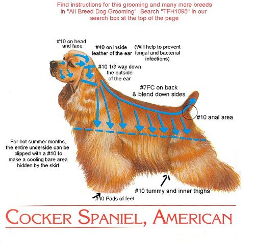
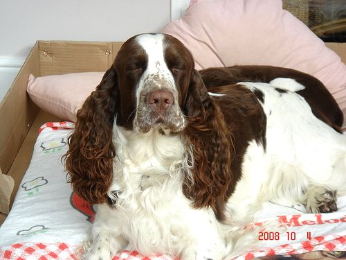
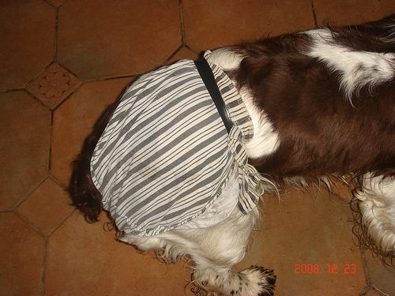

# 狗狗

感谢少爷提供给狗狗“理发”的信息。  
  
  
少爷养了一条史宾格犬，我的邻居有条史宾格和麦西一样一样花斑的，是警犬研究中心进口犬的第二代。据我对这两只狗的观察，近亲也有差别。  
  
史宾格：稳重、冷静，只认主人，对其他人比较冷淡。步伐轻盈、矫健；  
英卡：得瑟、易兴奋，小碎步，后脚有点内八字，天真的一塌糊涂。  
  
麦西，迷人的小样儿！  
回头想想LUKE，那头顶是杂草丛生哦~  
  
  
麦克是只5个月大的公狗，在英国公狗小于七个月，与母狗生下的小狗不能正规注册，算  
黑户口。当麦西遇到麦克，麦西穿上了内裤！   

---

## 评论（1）

**shao ye** · 2009-02-11

Great! Thank you for sharing this.  
I have visited your pet web page, loved every single bit of it.

