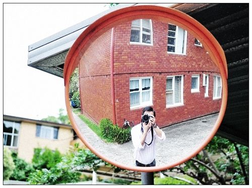
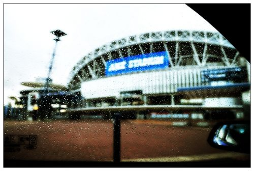
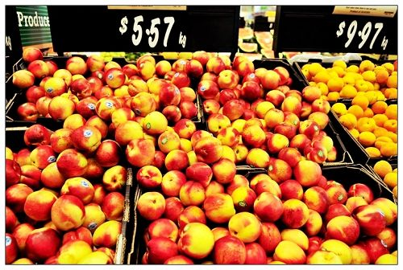
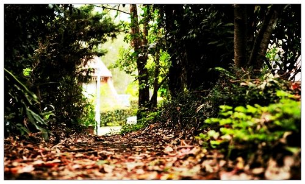
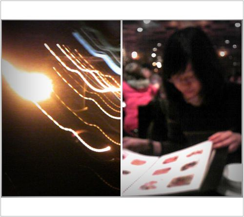

# 两个人的相机日志：2月11日

和薇安的相机日志持续一周，昨天结束。  
今天开始和在澳大利亚悉尼的jiajialing继续下面的相机日志。  
  
jiajialing是我现实生活中的好朋友，我的摄影一直跟随他的步伐前进的。  
可是我这个跟随者并没下太多功夫在研究理论上，更多的是随性而为。  
  
由于晚上和sherry约了见面，照片通过邮件传送过来。那么，今天我们将没有独白和相互的评语。澳洲快进入秋季了吗？以往他的相片能带出人内心里的东西，虽然他时常把我拍的很丑：）这次......仍然期待有佳片共享！  
   
   
   
   
  
这张是我用手机拍摄的。  
左图是个广告灯箱，右图是看菜单的sherry，这些光线的拖影和模糊的画面具有某种缺陷的美感。  

---

## 评论（14）

**Michael** · 2009-02-12

喜欢第四张,感觉第三张太红了些.  
看起来心里有点不舒服

**Sherry** · 2009-02-12

你偷拍我！^\_^

**Sherry** · 2009-02-12

澳洲那么美，佳佳多上些风光大片啊~~~  
期待。。。

**jiajialing** · 2009-02-12

第三张是我最喜欢吃的桃子，硬硬的，很爽口。。。

**Christina** · 2009-02-12

油桃吧？猴子都喜欢吃油桃，哈哈~  
我强烈要求多拍些生活场景，不想看什么大片！

**[薇安](http://www.bulaoge.com/?vivianxu)** · 2009-02-12

jiajialing拍的好赞~是胶片机吗

**Christina** · 2009-02-12

我喜欢第二张和桃子的！

**HANK** · 2009-02-12

我来帮着注一下并砸砖哈  
PIC 1: JIAJIA家停车场的转角.
画面有些乱,但是角度很新颖  
PIC 2: 悉尼奥运会主赛场门口
右上方的阴影能去掉就完美了  
PIC 3: 就一个感觉:WOOLWORTHS里的桃真贵!
(桃?又不是猴,吃那玩意干吗!——某天请某朋友吃桃,他给我的答复.转送JIAJIA).KAKA  
PIC 4: 某不知名小路. 估计JIAJIA是象个蜥蜴似的趴在地上拍的.赞一个.

**jiajialing** · 2009-02-12

我靠，人肉搜索。。。。。?

**Christina** · 2009-02-12

“JIAJIA是象个蜥蜴似的趴在地上拍的……..”  
他做的出来滴！哈哈哈哈~

今天问jiajia澳洲是什么季节，他说是冬天。另一个朋友说墨尔本现在40度高温……难道被森林大火烤成40度的？简直晕死了，后来jiajia说昏头了，现在是夏末。

**jiajialing** · 2009-02-12

我倒，那张照片我没爬在地下拍，只是吧相机放低了。。

森林大火死了快200人了，哀悼一下，拿场景和原子弹爆炸差不多。。。。

**afan** · 2009-02-12

秋季?  
http://www.news.com.au/common/imagedata/0,,6483404,00.jpg

已有一百八十人死亡，，欢迎捐款！  
https://www.redcross.org.au/Donations/onlineDonations.asp

**Martin** · 2009-02-12

D300!

**[pp](http://www.truewater.net)** · 2009-02-13

这个活动越来越有感觉了 照片拍的超赞

