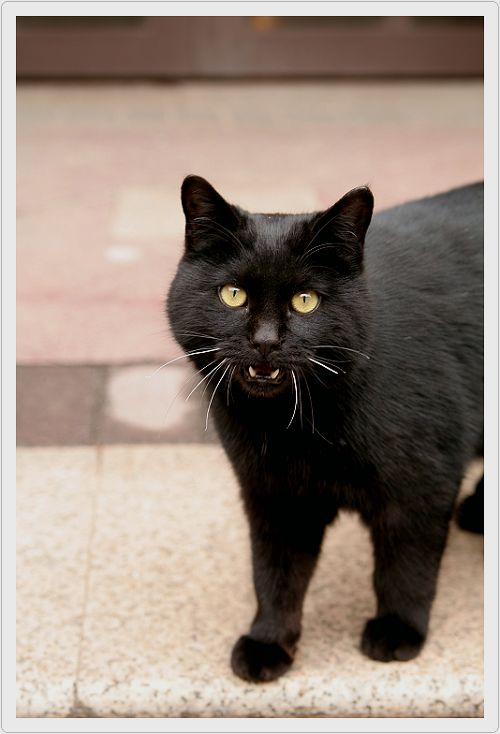
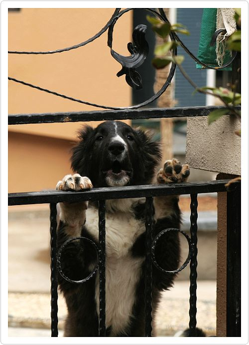
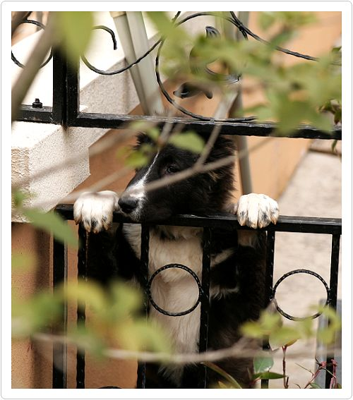
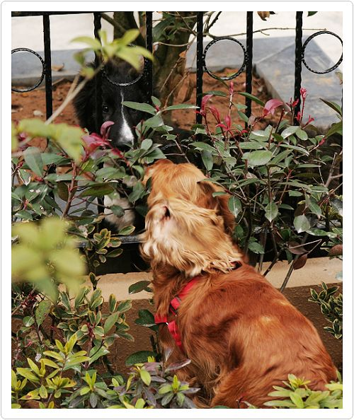
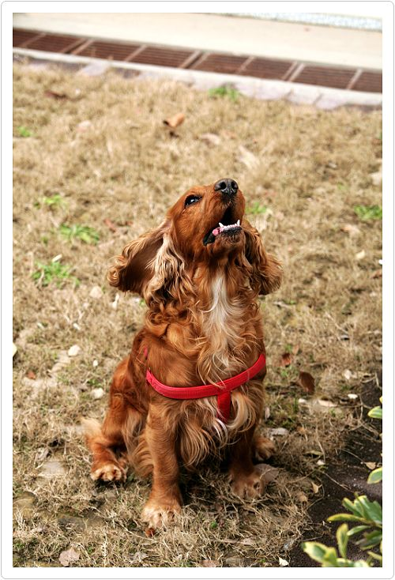

# 宠物世界

这是LUKE见着就追的埃及女王的黑猫；  
   
  
邻居家的高加索犬，是烈性犬哦。三个月大，个头已经比LUKE大了许多；  
   
  
趴着围栏看LUKE，那爪子跟戴着白手套似的。  
   
  
LUKE跳进院子外的小树丛和它亲亲嘴，就跑开了。  
自由是多么珍贵啊，看看LUKE和它就知道。  
   
  
LUKE守在树下冲着那只埃及女王的黑猫狂吠，凶狠的小白牙又暴露出来了。  

---

## 评论（3）

**大姜炖去** · 2009-02-14

终于识得小黑真面目  
瞧她那双眼睛  
深夜里肯定更吓人

**[少爷](http://jennyshaoye.blogbus.com/)** · 2009-02-14

楼上的才不对呢，那只黑猫多漂亮啊。可惜我的那只被车轧了：（

**mandy** · 2009-02-16

总觉得黑猫有点诡异~~LUKE只是龇眦牙，和我家的“黑黑”一比不知道要乖多少

