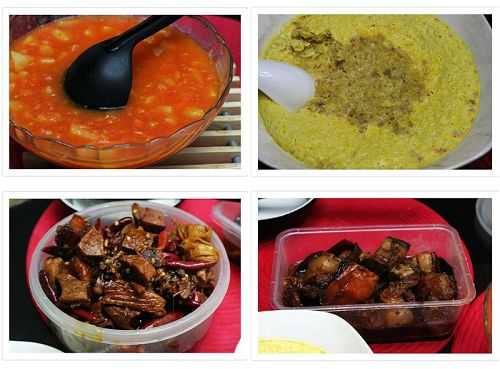

# 我爱美食

做饭，持之以恒地做饭。  
  
这周烧的最满意的四个菜：  
1、罗宋汤--用新鲜的去皮西红柿慢慢熬，配以自己炖的牛骨汤、胡萝卜、土豆；  
  
2、肉沫蒸蛋--不用细细写了，很简单。不过这是农村自家土鸡生的鸡蛋，烧出来的颜色比超市买的鸡蛋要黄；  
  
3、红烧牛肉牛筋--最喜欢吃牛筋之类的食品，沸水去掉肉上的血水脏漠，沥干。油热，放姜、牛肉，翻炒，倒入料酒、生抽，放入荤汤、葱、干辣椒、花椒，炖两个小时，牛肉差不多烂了，放进沸水煮熟的牛筋段，继续烧，起锅前放入糖收汁，加少许盐、鸡精；  
  
4、咸鱼炖五花肉--以前我是一点肥的都不能吃，一吃就吐。可是张生记的东坡肉我是可以连皮带肥都能吃下的，那个肥一点不腻。第一次烧这道菜，居然烧的很不错哇，完全凭着对爸妈做菜的印象。主要是五花肉要炖的时间长一些，把那个“肥腻”给炖掉。  
  

---

## 评论（11）

**大姜炖去** · 2009-02-21

罗宋汤看起来很美味  
肉沫蒸蛋上面加点醋的，不知会不会更好吃

**Cindy** · 2009-02-21

好香啊！真是：上得厅堂，入得厨房：）

**陈兴** · 2009-02-21

罗宋汤很诱人

**itsmin** · 2009-02-21

恩.估计你烧的这个牛筋跟我今天在外面吃到的萝卜牛筋牛腩煲有得一拼…厉害哦.

**Ivy** · 2009-02-23

美食我爱，做饭我也爱做，但没办法持之以恒的做。做多了，就会烦。 所以也不过是一个不是很勤奋的美食爱好者。

**Christina** · 2009-02-23

呵呵~从来没尝试过给蒸蛋加醋的吃法，下次试试。

我也是经过一段时间才适应每天做饭的，期间有那么一小段很是挣扎，感到很疲劳，但渐渐就适应了，而且还喜欢上了做菜。只是要想今天做什么明天做什么，这个比较烦~

**mandy** · 2009-02-23

做菜过程如同自己成功地完成一件作品，但是做好后总希望有人捧场和喝彩，如果无人来和我会：（~~哈哈~我的MSN怎么给你？

**Christina** · 2009-02-23

留言的时候写在EMAIL栏，我来添加你：）

**mandy** · 2009-02-23

OK？~~OK~~

**mandy** · 2009-02-23

Live,love,laugh

**lilian** · 2009-02-26

每天做？难怪进步那么快！

