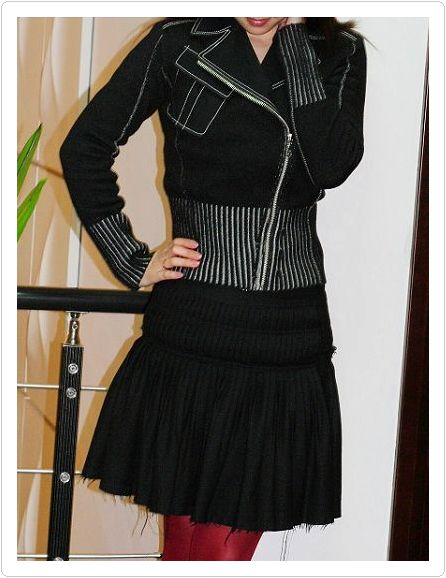

# 阴.雨.周

烂冬，不知道要持续到什么时候？  
这一周将仍然是阴雨天。  
  
雨天，基本上去哪里都不方便，连LUKE到外面便便也不方便了。还好，它不怕水，也喜欢洗澡和吹风，简直就是狗狗中的人精。园子里黄的粉的紫红的梅花开了许多，真怕花朵被连日的雨水打蔫了，太阳跑哪里度假去了呢？  
  
心情好食欲自然好。每天晚上都想吃水果，吃完苹果吃橙子，再在放零食的竹筐子里翻找想吃的东西。迷恋上一种芒果花生口味的酥饼，LUKE也喜欢吃，看电影的时候它一块，我一块，好不快乐！  
  
近期看的不是甩片就是枪战片，其中一部[**《The Lodger》**](http://www.verycd.com/topics/2728637/)老片新拍，还行。昨晚看了《疯狂的赛车》，和“石头”一样模仿[**Guy Ritchie**](http://baike.baidu.com/view/1148828.htm)的导演风格，不过模仿的还算不错。预定了两场话剧，之前一次次错过，这次终于买到票，期待中......  
  
星期一早晨在水房遇到一位同事阿姨。  
她说：“你今天好摩登啊。”  
“哦，说我吗？”  
“是啊，现在年轻人穿衣服我都理解不了，乱穿，破布烂棉花的，没品味...”  
...... ......  
水房暗，估计她没看到我那裙边...  

---

## 评论（10）

**Google阅读器** · 2009-02-23

灰常魔灯

**shao ye** · 2009-02-23

hey, girl, dogs can eat nuts. Does the cookie contain nuts???

**[joanna](http://yanmer.cn/blog)** · 2009-02-23

哪里摩登嘛？是“超级”摩登哦^o^。那双红色的丝袜肯定百分百回头率～～俺喜欢再暗一码的色系

**Sherry** · 2009-02-23

潮！

**mandy** · 2009-02-23

时尚~红袜子拉风~~关键还是身材好穿什么都好看~~

**YY** · 2009-02-24

呵，美女，有没有订恋爱的犀牛呢，我看过了，很好看哦～

**Christina** · 2009-02-24

那个小酥饼没有坚果，嘿嘿~  
发现他喜欢吃蛋糕、糕点，不过有巧克力的糕点坚决不给它吃，巧克力中的某个原料，人类是可以排泄出体外的，但是狗狗却不能。

昨天晚上给他吃我们吃剩的青菜汤，他居然也吃了，还把青菜吃的干干净净，那一刻我简直太兴奋了！

**Christina** · 2009-02-24

订了《恋爱中的犀牛》和《两只狗对生活的意见》：D

据说这次“犀牛”是10年来的新版，还不错~

**lilian** · 2009-02-26

哇，红色的袜子，我喜欢！

**Yucheng** · 2009-02-27

呵呵，我同事小姑娘每次都要指着我的牛仔裤说，唉哟哟，这么多钱，买条破的！

