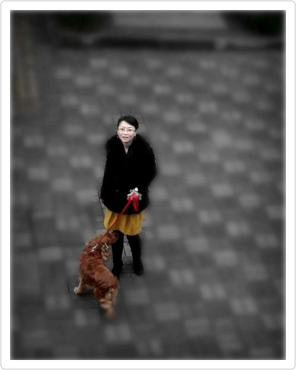

# 持续的雨天

乘着中午没有下大雨，赶紧带LUKE出去便便。  
从一天两次减少到一天只能出去一次。  
LUKE，是逆来顺受型，一天一次便便也可以？  
  
天气就象这色调一样阴沉，昨晚还雷电交加，据说日平均气温在10度以上，才算真正进入春季。理论上说打雷一年四季都会出现，只是冬天出现的机率相对少一些。在我的概念里，春天到了才会打雷。新闻说后天有可能出现雨加雪~无论冬天还是春天，都希望这雨水暂时停一停。  
  
这张相片是俺家终点工拍的，还不错吧？呵呵~  
她是从大山里来的，一家四口都在南京打工，人很本份也很传统，话不多。说是过两三年挣点钱，一家人回陕西老家盖个房子，不会在城里生活的。农民不工作还有土地，城里人呢？乱糟糟地挤在一个地方，争来斗去头破血流，也就是一日三餐，一间房，一张床，一次生命。  

---

## 评论（12）

**shao ye** · 2009-02-25

love your yellow skirt. Luke should have at least twice walk daily. He is so nice, no complain at all,hehe.my dogs have four times walk a day. Dogs are happier if they have more outdoor activities.

**itsmin** · 2009-02-25

上海的天气也是一片阴冷。不过对比广州的潮热天气，还是冷点舒服。

**jiajialing** · 2009-02-25

拍的真好。。。。

**[红裤子](http://yongsr.blogcn.com/index.shtml)** · 2009-02-26

农民不工作还有土地，城里人呢？乱糟糟地挤在一个地方，争来斗去头破血流，也就是一日三餐，一间房，一张床，一次生命。

说的真好，我父母还家里大多数亲戚现在都在农村，每次回家都能从他们嘴里听到通俗但是绝对看穿世事的语言。  
也许城里人就像是身在庐山不识真面目，留下农村人在旁边有点像看热闹似的，看得清清楚楚。

**Christina** · 2009-02-26

“留下农村人在旁边有点像看热闹似的，看得清清楚楚……”

经典！所谓旁观者清嘛~呵呵~

jiajia，你没有看到原图，基本上我只占原图的几十分之一的面积，这是截下来的，哈哈哈哈~

**lilian** · 2009-02-26

我的周围为什么看不到一个坚持在冬天穿裙子的女生……

**Michael** · 2009-02-27

这是PS的图还是照的?

**Michael** · 2009-02-27

本人PS水平很一般. 只会扣扣文字什么的,见谅

**Christina** · 2009-02-27

请教“叫兽”，不草率，应该怎么处理？

**Yucheng** · 2009-02-27

本来想夸奖你家钟点工的摄影技术，现在只好夸奖她的安分守己，知足常乐。

烦恼，确实是自找的。

想要快乐，就要认清自己，降低欲望，做爱做的事，爱该爱的人。

**清雅茶事** · 2009-03-01

看见的是傻傻的天真样子的女人

**Christina** · 2009-03-02

那表情是挺傻的，呵呵~

