# 上海街道

**仅半天时间，随意地拍摄，回家翻看相片，却看到与以往不同的上海。**  
  
上海和南京一样依然是阴雨天，天色灰蒙蒙的，这座电话亭让人眼前一亮；  
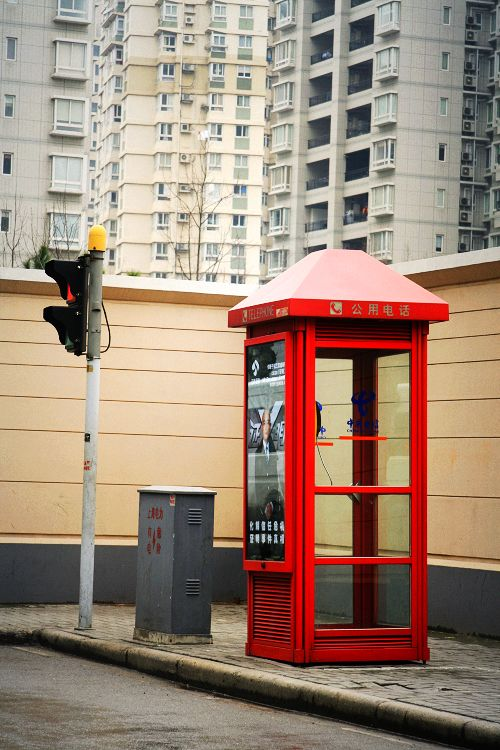   
《收获》杂志社居然在这里，09年我又开始续订《收获》杂志了。  
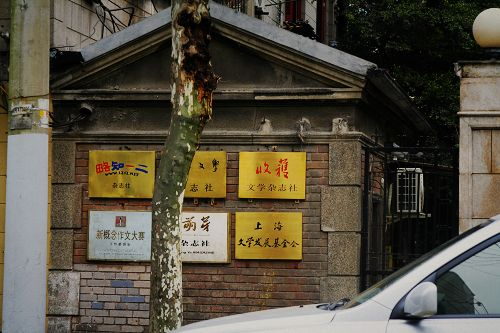   
  
写着“苔青”的店门禁闭着，因此，苔青于我就是空白的茫然；  
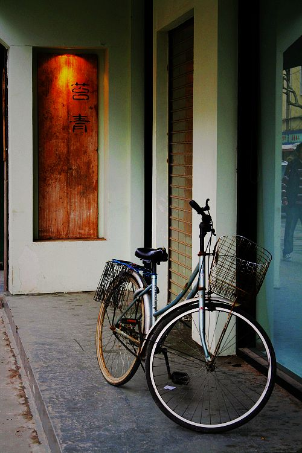   
  
生锈的门把手，又好象是门牌号码？  
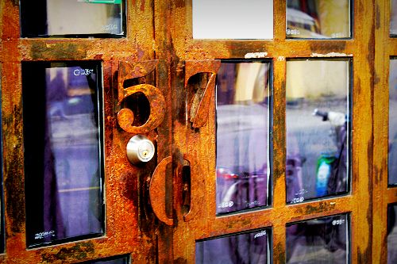   
  
两扇黑油油的大门虚掩着，里面别有洞天；  
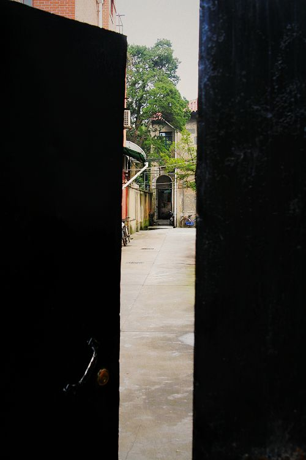   
  
好可爱的信箱，有点欧式的感觉，真不知是哪个年代的东西了？  
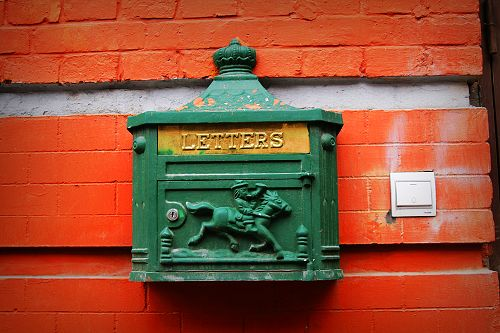   
  
这是一间家具设计店的大门；  
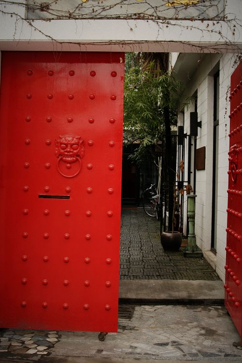   
  
拥挤的街道上忽然出现这样一幕风景，是不是有些诧异？那里面通向的是什么样的院落呢？  
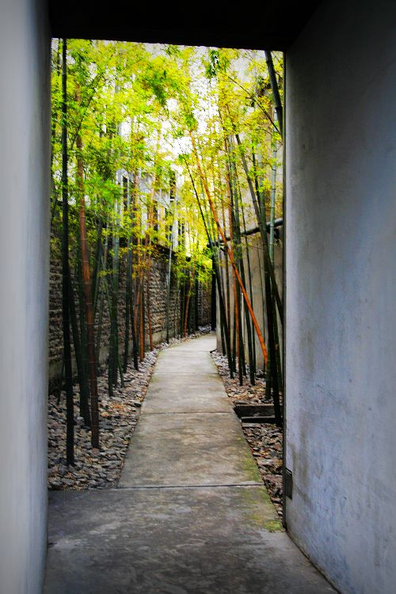   
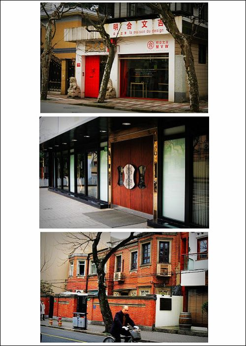   
  
小街道的墙壁被刷上鲜亮的色彩，连窗户外的围栏拐角也被细心地包上了棉布。  
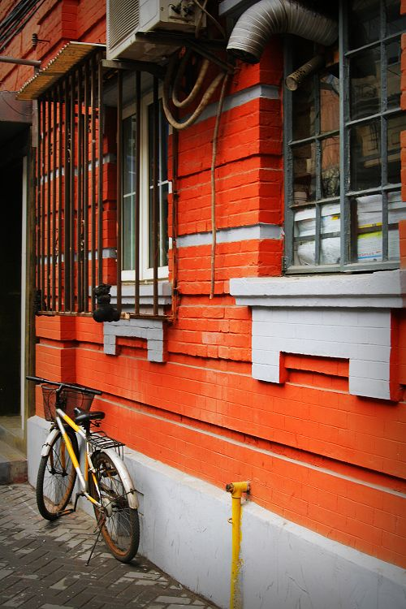   
  
消防栓？  
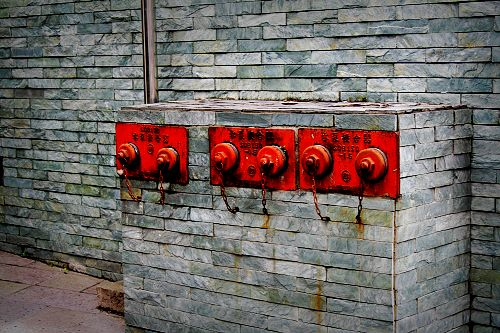   
  
这防护也能想出来？真是PF。  
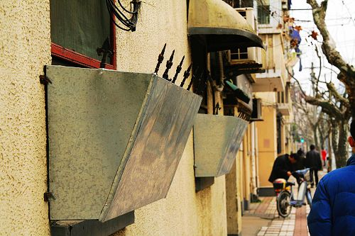

---

## 评论（8）

**大姜炖去** · 2009-03-03

原来你是来上海看话剧，呵呵  
带着相机，走走停停，也蛮有意思的

**Michael** · 2009-03-03

那张黑色的门的好. 看起来有点一人巷的感觉！  
还有其它几张门锁的拍的不错

**Sherry** · 2009-03-03

上海真是好干净，上海人倒是很有心，讲究细节，生活也变得精致起来。你也很有心哦！

**lilian** · 2009-03-03

跟我天天见到的上海不同，让人很放松：）

**Yucheng** · 2009-03-03

我喜欢那个带门牌号码的门把手

**Nana** · 2009-03-03

每次去上海就是 酒店 salsa 吧 无聊死了  
下次要好好的 去看看上海

**mandy** · 2009-03-03

每次去上海就是火车站-出租车-会议室里呆一天，行程都很匆忙，看到的都是人来人往，纷乱嘈杂。希望下次也能静下心来好好看看。

**walkman** · 2009-03-04

嗯，和樓上幾位同樣的想法，下次去上海要好好走走  
呵呵  
關注你的博客很久了，一直很喜歡

