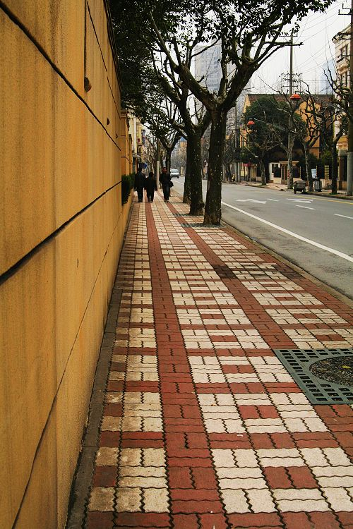
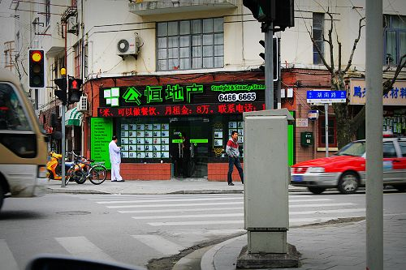
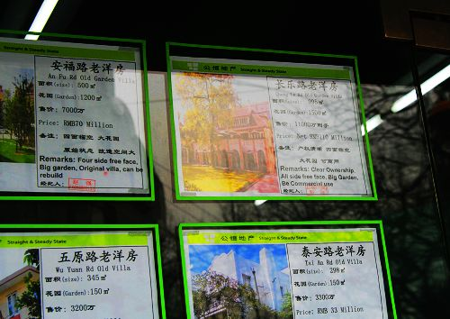
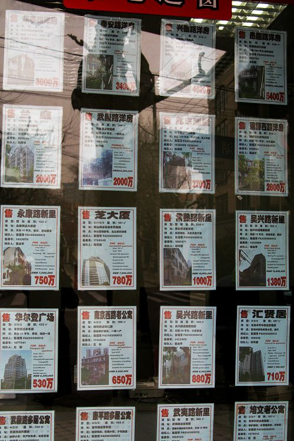

# 上海．武康路

不到上海，不知道自己有多穷。  
到了上海的武康路，自个儿就是一穷光蛋了。  
  
上海的武康路与南京宁海路相似，许多老式花园洋房很低调的错落在围墙里面，朴素而安静。最便宜的都是小几千万，最贵的一套500平米带个花园的洋房要1.1亿，晕纳。据说有些洋房花钱都买不到，这哪里是有钱人住的房子，而是资本家住的地方。那些洋房看起来一点不起眼，不细心看很容易就错过了。也有些72家房客的普通民宅，有些被有钱人动迁下来了。那些洋房看着很不起眼，但都是张爱玲式的公寓，陈丹燕笔下的小楼。有些是市府的，离休干部的，上海的风花雪月，基本都在那一带了。  
  
有个朋友说：“几千万不够在上海买房子，不如移民加拿大吃利息。”  
我在想卖房子的人得缴多少税给政府啊？  
嗨，做白日梦的和瞎操心的碰到一起，也只能站在围墙外面看看。  
   
   
   

---

## 评论（4）

**Sherry** · 2009-03-03

上海人的精明势力见人下菜，都是穷出来的。

**lilian** · 2009-03-03

也是一种生存方式吧，不喜欢，但理解。。。

**Yucheng** · 2009-03-03

那个1.1亿的，好象是1500平方米的。花园也很大。又是在上海的市中心，法租界，这样的房子，出来的少，必然是高价了。

总之，那是离我们这种普通人太遥远的生活了，当风景看看，还是不错的。

不是每一样好东西都一定要拥有，但是，我们可以欣赏，养眼，养心。

**Michael** · 2009-03-05

这个房价还让人活不?

