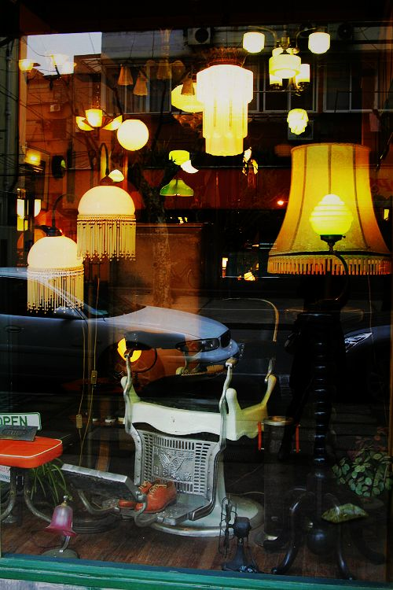
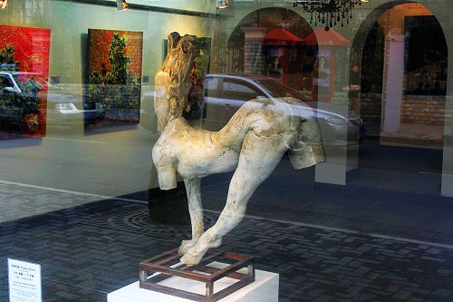
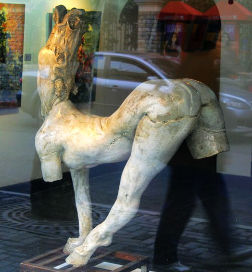

# 上海．橱窗

私人店面，橱窗里有张旧时理发店理发用的椅子，80年代常常能见着的，看到它，就想到热气腾腾跗面的毛巾，师傅手上的剃头刀在绷带上来回打磨的情形...如今这张椅子象古董一样放置在橱窗里了。  
   
  
路过一个艺术画廊，门面非常小，被里面屹立着的雕塑所吸引，残缺却充满力量，复杂的对抗与挣扎？不屈不饶，痛苦的坚持？畸形的美？绝望？  
   

---

## 评论（2）

**大姜炖去** · 2009-03-03

不屈的半人马？

**shao ye** · 2009-03-04

hey, wish you all the best with the operation. Fingers cross for you.

