# 上海．人

上海火车站．人  
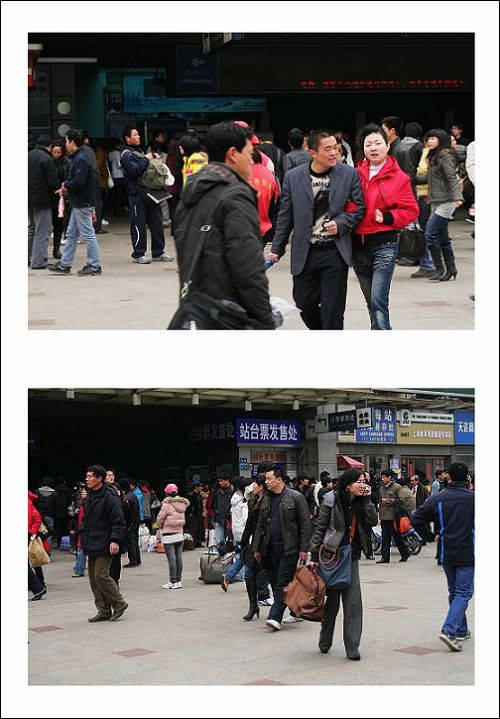   
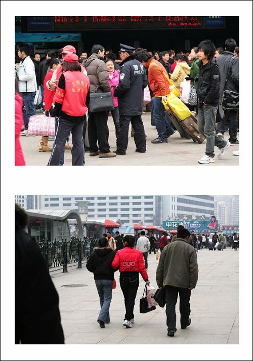   
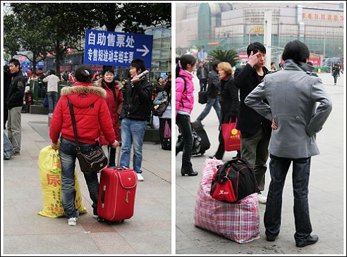  
  
城区．人  
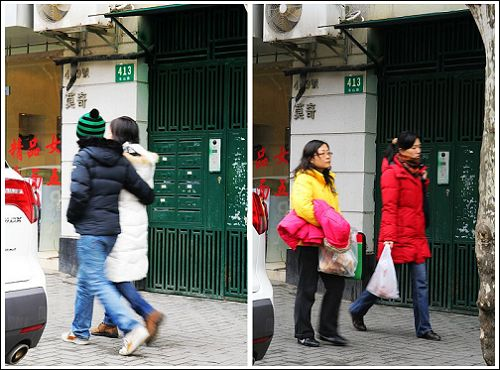   
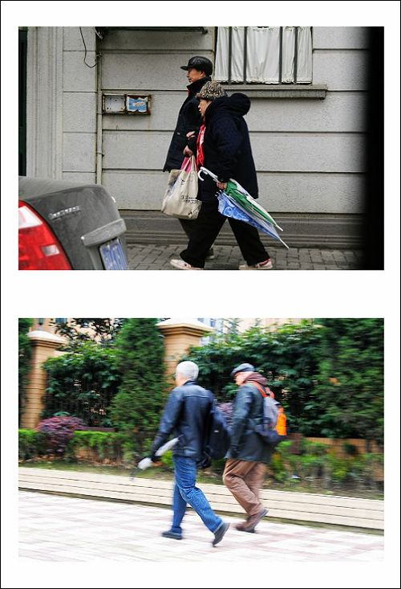   
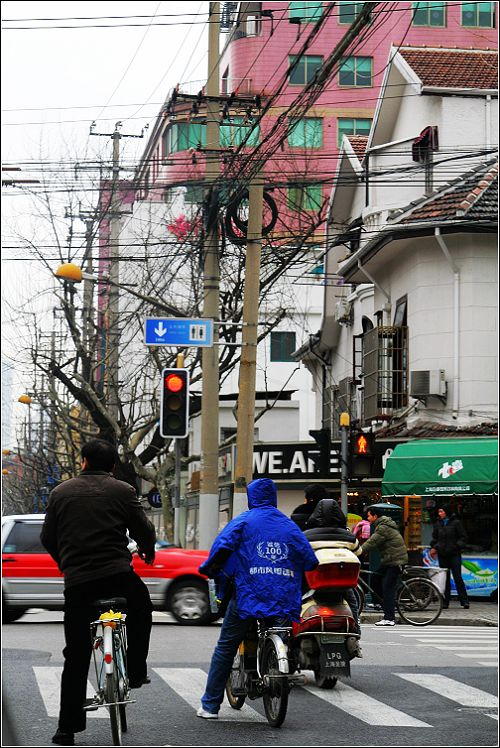   
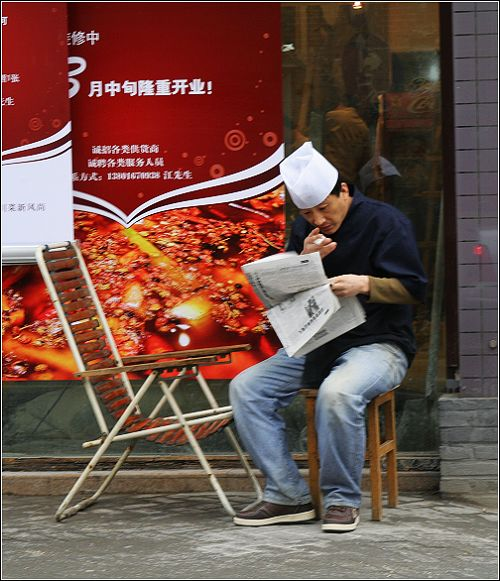   
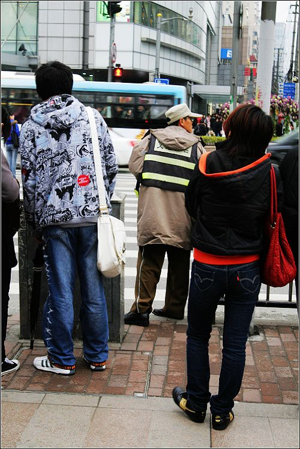   
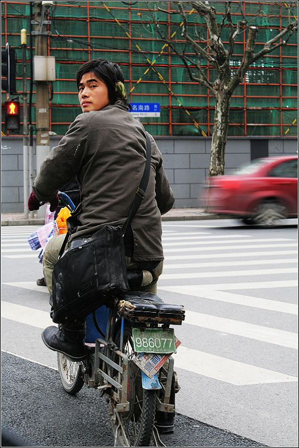  
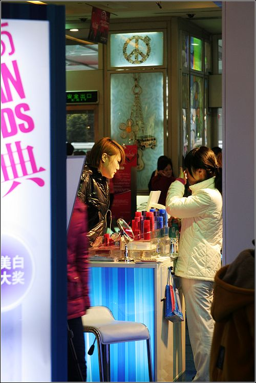   
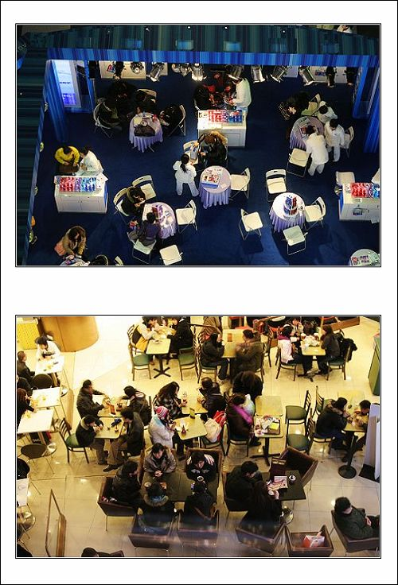   
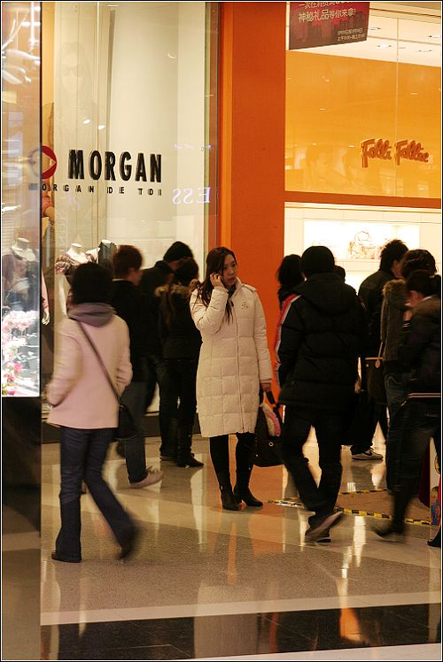

---

## 评论（4）

**shao ye** · 2009-03-06

It looks very very very very coooollllllldddd

**okdata** · 2009-03-06

熟悉的场景。  
站前幸福的男女，LaCross旁的老人，摩根大通前的过客和茂名路上那讨生活的男子，真实的城市

**[joanna](http://yanmer.cn)** · 2009-03-06

最近的照片，色调都好漂亮。用的啥子软件修D?

**老游客** · 2009-03-08

天涯上的有个美女长得和你很像，只不过脸比你胖点，呵呵  
http://www.tianya.cn/publicforum/content/tianyamyself/1/82272.shtml

