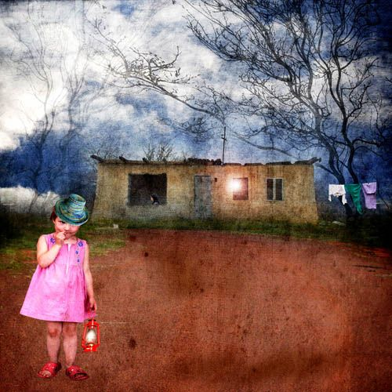

# 如果．美好

如果每天只工作半天、有现成的午餐、LUKE不被发情的母狗折磨、鞋柜的门不会神经质地弹开，如果，人可以不生病，就更美好了。  
  

---

## 评论（8）

**Maggie** · 2009-03-09

沙发！春天来了，太阳暖了！

**shao ye** · 2009-03-09

hmm, that would be nicer

**itsmin** · 2009-03-09

是啊. 许多的小幸福会累积成大幸福的.

**大姜炖去** · 2009-03-09

保重身体，开心一些，没有什么可以困住你

**[Catherine](http://forucy.blogcn.com)** · 2009-03-10

偶今天没去上班.在家养病……..

**mandy** · 2009-03-10

怕生病~~因为记得妈妈说的话，人生病时身边连个递药倒水的人都没有~~保重~~

**lilian** · 2009-03-11

如果一年中有三个月时间是可以由我自由支配那该多好。。。。。。

**Michael** · 2009-03-11

早一点实现共产主义.这样也不会太累

