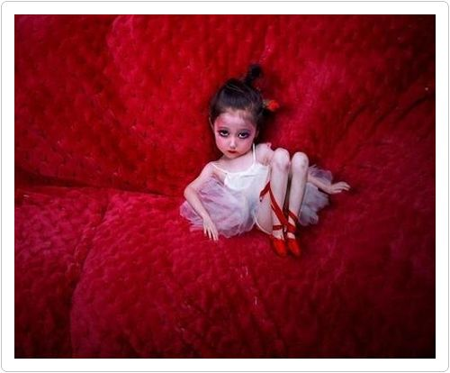
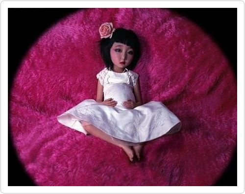
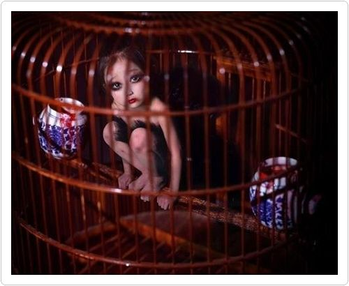
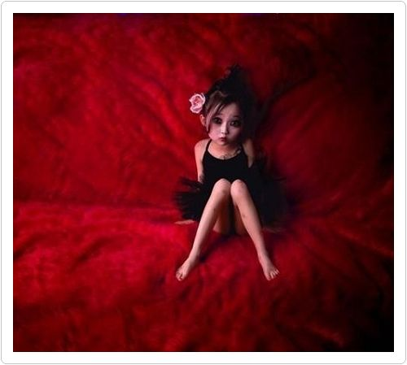
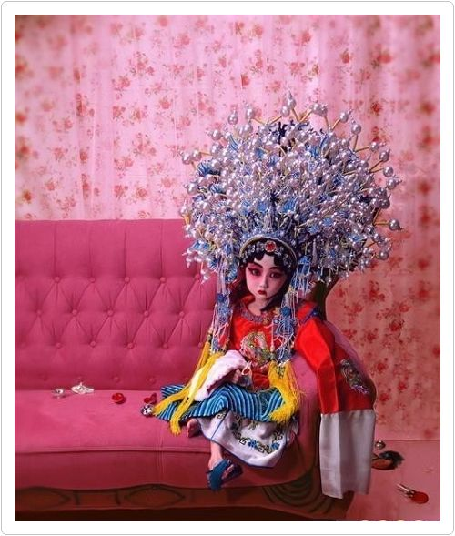

# 悲观主义的花朵

这个周末《恋爱的犀牛》就要等着我去膜拜那些[**“经典的台词”**](http://www.enet.com.cn/article/2005/0208/A20050208389919.shtml)了，上个月Angie定了两张票。她说已经看腻我的发型，让我这次在上海把头发全剪了......其实我自己也腻了，常拿发卡把刘海夹成奇形怪状，难怪有同事说：“你怎么这么个发型啊，最近怪怪的。”其实不需要剪，它也会象落叶一样凋零。  
  
听yucheng说在上海的剧院里看到过廖一梅，安静而低调的站在幕边，面带微微的笑，清新可人的摸样，一点不起眼。yucheng是带着妈妈、外婆和丈夫一起去看的这部话剧，看完后她的妈妈快乐而满足。据说《恋爱的犀牛》演出十年来，这次是改编后的新版，虽说不再是大牌演员出演，想到能亲耳凝听并感受那些所谓的经典台词，便渐渐兴奋。如果你也想体会一下这部话剧的经典，3月27日-3月29日他们还将在[**杭州大剧院**](http://www.piao.com.cn/hangzhou/ticket_1626.html)演出。  
  
每每要跑去上海看喜欢的节目，才体会到大城市的优越之处。本来，对上海是万万没有好印象的，受了yucheng这个土生土长上海人的影响，逐渐转变看上海的角度，并且为陈丹燕笔下的上海女子套上yucheng的形象，实在是想象不出还有哪个上海女子更符合的了。四月本来有一场[**OASIS**](http://www.google.cn/music/artist?id=A212c4bea6a24b59a)在上海的演唱会，等我在网上定票时才发现已经开始办理退票了，是因为他们支持藏独而被迫取消在中国市场的演出吗？  
  
看话剧前先热个身，捧着廖一梅的小说《悲观主义的花朵》看了看。真巧，在所有鬼怪中我最喜欢的也是吸血鬼。那些插图是某网站[**某00后小女孩写真**](http://picture.free.21cn.com/folder/1662,1917725,0,0,1.shtml)，除了鬼秘，惊悚，颓废还有血腥，没忍心放这里血腥的。这组写真的一部分还是挺酷的，我爸妈如果给小时候的我整这么一组相片，成年后我就给你们看，让你们羡慕死我，那不仅仅是酷，简直就是重金属摇滚的童年！事实上我的童年照片还真少…孩子都这么拍写真了，赶明我们是不是就可以创意地叼着奶嘴，半裸的垫着尿不湿出现在写真集里了呢？谁不怀念童年啊，尤其经济不好的时期，有人管吃管住，想玩就玩想睡就睡，还不用上班！童年简直是太酷了！  
  
  
  
摘抄自廖一梅的小说《悲观主义的花朵》：  
  
为爱而生，很多人这样标榜自己，为爱而生？不，我不为爱而生，爱是我躲之不及的怪物，是人生对我抛出的媚眼，顾盼有情中生出的一点眷恋，是这世界将你抽空、打倒，使你放弃尊严的唯一利器。别大言不惭地谈论为爱而生吧。  
  
我们一生中总要遭遇离开心爱人的痛苦，那可能是分手，也可能是死亡，对此即使我们早有准备也无力承当。人类唯一应该接受的教育就是如何面对这种痛苦，但是从来没有人教给过我，我们都是独个地默默忍受，默默摸索，默默绝望。  
  
我知道我终将老去，没有人能阻止这件事的发生，你的爱情也不能。我将从现在起衰老下去，开始是悄无声息地，然后是大张旗鼓地，直到有一天你看到我会感到惊讶----你爱的人也会变成另一个摸样。  
  
我们都会变成另一个摸样，尽管我们都不相信。  
  
我们从年轻变得成熟的过程，不过是一个对自己欲望、言行的毫无道理与荒唐可笑慢慢习以为常的过程，某一天，当我明白其实我们并不具备获得幸福的天性，年轻时长期折磨着我的痛苦便消逝了。  
  
“凡是改变不了的事我们只能逆来顺受。”我们的需求相互矛盾、瞬息万变、混乱不堪，没有哪一位神祗给予的东西能令我们获得永恒的幸福。  
  
对于人的天性我既不抱有好感，也不抱有信任。  
生活的真实性都值得怀疑，其他的就更别说了。  
  
  
  
......我惊讶地发现，从小热爱的那些诗人作家个个放荡不羁、道德败坏，被人指责为寡廉鲜耻。第一个是拜伦，然后是王尔德。  
......总之，我是一个不能确定的、勉强可以被称为好学生的人。这勉强已经预示了我将开始摸棱两可、左右为难的人生，准备遵守世俗的准则，而在内心偷偷爱着拜伦和王尔德，渴望与众不同的生活。  
  
“犯罪不是庸俗，但所有的庸俗都是犯罪。”  
“只有特别之物才能留存下来。”特别，就不论善恶。我寻求特别之物。  
“我不仅要做一个恶棍，而且要成为一个怪物，你们会宽恕我所做的一切。换句话说，我要把你们的衡量标准变成荒唐可爱的东西。”  
这是我知道的、最令我颤抖的豪言壮语，在一百年以前，被最优雅的人用优雅的态度说出，比长发愤怒青年的重金属喊叫更对我的胃口。  
  
......“可以理解，道德败坏的人没有禁忌，更加有趣。”  
“有趣”----我努力想追求正确的生活，实际上却一心向往有趣的生活。但我既缺乏力量，又不够决断，追逐这种并不适合于我的生活的必然结果是痛苦多于欢乐。但那时我坚持相信那个“白痴”公爵梅希金的说法：“她的眼睛里有着那么深的痛苦，是多么美丽啊！”  
  
  
  
确立某种生活准则，并有勇气去坚持这些准则是必要的。可惜大家通常既无勇气坚持善，也无勇气坚持恶，甚至没有勇气坚持随波逐流。更加不幸的是，我对他人有一种与生俱来的领悟力，有了这份本不必的理解，做起事来便难免拖泥带水，对一切都失去了明确的尺度。这对我的生活是个致命的错误。  
  
错误当然不都是丑陋的，有些东西因为错误而格外耀眼。  
  
说说我为什么喜欢吸血鬼，你会明白我要的是什么样的爱情。  
吸血鬼的爱情有着爱情中一切吸引我的东西，致死的激情，永恒的欲望，征服与被征服，施虐与受虐，与快感相生相伴的忧伤，在痛楚和迷狂中获得永生......  
我不知道谁能带给我这样的爱情。  
  
  
  
......出于怜悯原谅了他，不是对他的怜悯，而是对人类的怜悯，对自己的怜悯。我们都将怜悯自己，因为我们既无从了解自己，也无法把握自己，我们没有运气成为幸运儿，成为爱情的劫后余生者，生活的劫后余生者，我们只能显得可笑、卑微、没有其他的可能。  
如果不能原谅他，我难道能原谅自己做过的那些荒唐事吗？  
唯一能够指责他的，是他缺少面对这一切的勇气。  
  
以前有两样东西我是相信的----一个是理性，一个是表达。对于陈天的爱情摧毁了我唯一相信的两样东西。  
  
爱情，你忍不住要伸了手去握紧它，可握住的时候已经碎在手里了。  
  
  
  
我经常会产生这样的错觉，觉得我的生活不过是一部电影，下面就要出现一组表示岁月流逝的镜头，再转回来，那些痛苦、绝望的日子已经过去很久，另一个故事又会开始。每一次我都惊讶地发现，居然我还坐在我的蓝色转椅里，什么都没有改变。  
  
其实我们能向生命祈求的只有好运，没有公平，没有意义，没有解释，没有响应......  
如果你有好运，恭喜你了。

---

## 评论（12）

**Edward** · 2009-03-12

照片还蛮恐怖的~~

**Sherry** · 2009-03-12

额~~这照片有点接受不了。。  
看多了这样的书心会比较累，想法少一点比较容易开心啊~~

**[Yucheng](http://xbtxbt.spaces.live.com/)** · 2009-03-12

哈哈，上海女孩子要是听到，99%不同意拿我做代表的。

《悲观主义的花朵》里面有n多的好台词，看这本书，完全可以当作话剧剧本一般的看。边看，边朗读。

“当然，我一直是个悲观主义者，认为这个非我所愿而来，没有目的也没有意义的生命是个不折不扣的负担。只是凭着悲壮的热情和保持尊严的企图，我才背起了这个负担，同样出于尊严还要要求自己背得又稳又好。但那阵子我对这个工作失去了热情。

　我试图寻找意义。”

我还喜欢里面提到的那首歌：

“欢迎来到你的人生，  
这是一条不归路。  
大幕已经拉开，  
你得扮演好你的角色……”

BTW，我没有带外婆去.不过，如果带了，她也一定会喜欢的.

**Michael** · 2009-03-12

照片里面的小孩要是能笑一笑就好了  
地球转36500天我们就都挂了. 积极的心态对一个人一生都很重要.  
最近听我朋友讲了句话,虽然不好听,但感觉是实话:生活就像被强奸,当你无力反抗的时候也就开始慢慢享受起来了”

**itsmin** · 2009-03-12

照片很另类…额不稀饭. 书有点深奥,可能因为看不大懂,所以有点不以为然… 感觉作者就是在一象牙塔内自说自话, 与世隔绝.

**Christina** · 2009-03-12

没有生活体验的人是无法写出这些文字的。阅读还是很享受的。

**Yucheng** · 2009-03-12

看到很多人的担忧。让我想起很久以前看《琥珀》时的宣传册里面有这么一段话：

有一种乐观主义，是建立在认识到人生不可避免的一些悲伤的事情的基础之上的，是建立在悲观主义基础之上的乐观主义，个人认为，是真正的乐观主义

**Christina** · 2009-03-12

“建立在认识到人生不可避免的一些悲伤的事情的基础之上的，是建立在悲观主义基础之上的乐观主义”

恩，我现在就是这样的乐观。无奈的乐观。  
但总好过整天悲伤。

**mandy** · 2009-03-12

看了图片我怎么觉得有点瘆人？ 还是乐观一些好吧~~

**bluelotus** · 2009-03-12

你想把头发剪成什么样子的呢？我蛮喜欢你这样长发的样子，巴不得一夜就能长你那么长：）

**Christina** · 2009-03-13

彻底改变只能是光头了，否则也就是小改改，呵呵~

**zoëの小美梦** · 2009-04-11

找这一系列图片好久了 可以告诉我是谁的作品么 谢谢 如果可以 发到我邮箱吧

