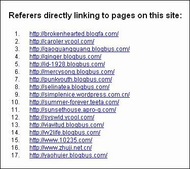
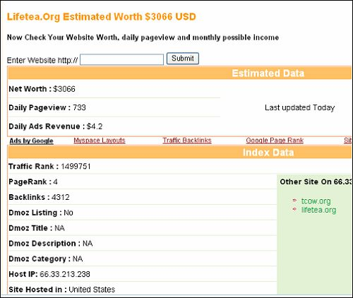

# 有意思

从访问记录里发现这些有趣的数据。  
  
部分连接茶的网址；  
   
  
下图是茶在某站上测算的价值USD3066.00，从数字上看就一点点啦，从意义上讲还不错。  
出于好玩，键入我们公司的网址，净值是USD1832.30，点击率 4237778。  
可登陆这个网站测试一下你的BLOG：[**http://www.websiteoutlook.com/**](http://www.websiteoutlook.com/)  
  

---

## 评论（2）

**[Jonathan](http://www.douban.com/people/1825883/notes)** · 2009-03-13

算了算，基本上，它是假设，如果要收购你的网站，则需要支付你两年的网站收入（Net worth3066=Daily Ads revenue4.2\*365\*2）.

**shao ye** · 2009-03-13

hey, you link does not show mine

