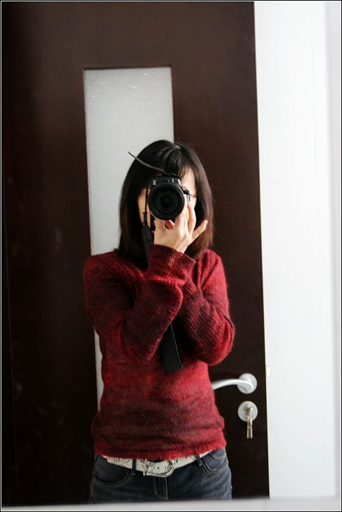
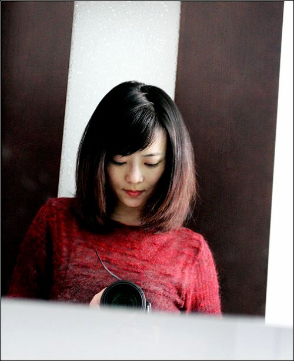
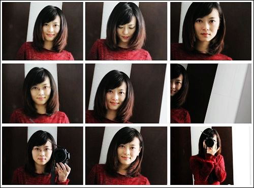

# 眼睁睁地看。。。

Luke终于一改以前的胆怯，睁大眼睛看人了。  
  
它喜欢一只白色高贵的萨摩耶，别的公狗想要亲近它喜欢的萨摩耶，Luke会疯狂地将对方驱逐，即使它的体型只有对方的1/2大。狗狗的一切都与原始欲望联系在一起，吃喝拉撒睡，出去玩，追逐喜欢的异性，在她面前做出各种奇怪的小样儿，逗她开心。青年的Luke发起嗲来，真是。。。别看它一副小老头的摸样。  
  
我在去上海的火车上，便开始想它了。  
   
  
  
这对我来说就是短发。  
喜欢头发看上去很多很多的样子。  
就象喜欢浓郁的，很正很正的颜色一样。  
头发上半部分是新鲜的黑色，而下面则因为染发烫发的缘故有些枯萎。  
为什么不继续黑色呢？我是那么喜欢黑色。  
以后要多多保护健康黑色的头发。  
  
今天得知33岁女演员李钰患淋巴癌去世，医学专业人士说每个人体内都带有癌细胞，如果没有充足的睡眠、健康均衡的饮食、良好的卫生习惯和自我调节情绪的能力，在抵抗力下降的时候癌就会发作。李钰的病和生活不规律，经常染发烫发有关，是这样么？而且经常感冒的人也要特别注意。  
  
有个女朋友将烫发染发一起做了，头发烫的不满意，生气地去超市买东西。一位老先生目不转睛地看了她好久，恶狠狠地说：“中国人的黑头发最漂亮，我是医生，你知不知道染发会致癌啊？”本来就生气的她，听到这话差点哭出来。  
   
   

---

## 评论（19）

**enriquesun** · 2009-03-16

怎么感觉头发更厚了，  
热哦

**Christina** · 2009-03-16

反季节，反季节，呵呵~~

**陈兴** · 2009-03-16

漂亮

**农妇某人** · 2009-03-16

有空欢迎常来转转……那照片如果给你震撼，可以想象我的震撼……现在的头发比长头发看起来显得成熟典雅，但要注意打理，因为一不注意就容易显老。

**Sherry** · 2009-03-16

呀，换发型啦？不错，戴上眼镜更好看~~

**[美味苏苏](http://tyhm.spaces.live.com/)** · 2009-03-16

这个短发衬得你娇嫩年轻。。

**Michael** · 2009-03-16

脸部有点背光

**itsmin** · 2009-03-16

觉得没有原来好看。不过，改变可能是件好事。。。Change we need!

**邃** · 2009-03-17

这样的发型是要配合妆容的，不过，尝试一下也挺好，我长发飘飘很多年了，也厌烦了，但是没有勇气改变！

**Christina** · 2009-03-17

恩，短发是需要衣装来衬托的。  
如果皮肤很好面孔娇好，衣服稍微朴素些也可以。

**宝儿** · 2009-03-17

亲，你的皮肤很好哦，想知道是怎么保养的，嘻嘻

**Christina** · 2009-03-17

其实不好呀，有雀斑，因为皮肤细腻而容易生皱纹。

睡眠吧，除此之外没别的保养了，偶尔贴张面膜，现在用的是日本眼霜，妮维雅的日霜和夜霜，资生堂的水。而且我还不怎么吃蔬菜水果，喜欢吃荤的。比较喜欢吃牛筋、鸭掌、鸡爪子、诸如筋筋皮皮的荤食。

女性年轻与否和体内雌性激素也有关吧？

**mandy** · 2009-03-17

美女~你喜欢吃的牛筋、鸭掌、鸡爪子、诸如筋筋皮皮的荤食。都是含有胶原蛋白高的食物，能使皮肤保持润滑而富有弹性呢~~会吃~~

**lilian** · 2009-03-17

发型很漂亮,不过打理起来太麻烦.

**Christina** · 2009-03-17

一点不麻烦，不要将层次打的太大，太薄，这样洗完头吹干就好了。早晨起来翘的地方喷点水，吹一下，很快的。直发比卷发好打理。我还想再短点。。。

**宝儿** · 2009-03-18

还是笑起来更好看呢

**Sherry** · 2009-03-18

不要再短了。。不女人了。。蓬松的感觉很不错啊~~

**[薇安](http://bulaoge.com/?vivianxu)** · 2009-03-20

颜色怎么会不一样呢，你又没染 。不过我喜欢你直发，我现在也是短直发

**[prettymom](http://prettymom.org)** · 2009-03-20

i like your hair. i’m going to get this cut next time.

