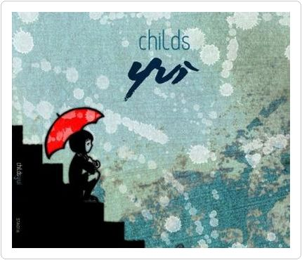

# 清冷的星期天晚上

在光光blog上听到Childs的《Yui》专辑里的[**“Mariana”**](http://www.musuns.com/bbs/UploadFiles/20093111106419.mp3)，听起来会以为是Lounge，而Allmusic网站将其归类为Pop-Rock风格，还是认同权威的归类吧。Childs是墨西哥的二人乐队，同时他们还是日韩动谩迷。这首电子风浓郁的Mariana，旋律动听流畅，弦乐较重，象这个周末的天气一样，雷电交加，深灰色的白昼，经历一场高速而悲伤的电影？这样的音乐多么适合于清冷的星期天晚上啊~有人说这张专辑里的[**“Ian P”**](http://audio.digital-tunes.net/clips/yui_1/10_Ian-P--Ian-P-.mp3)最好别在深夜藏着听，会流泪。  
  
前年公司体检，我的白细胞查出偏低，其他血常规正常。白细胞降低可能抵抗力也会降低吧？一直没弄明白是什么造成白细胞降低的，不过今天读到一则文字说汽油中含苯，长期开车应多化验血常规，若白细胞明显下降，说明对苯敏感，要十分小心。  
  
我还染上睡前吃东西的坏习惯，而且特别想吃，不吃会觉得饿。  
  
专辑名称：Yui   
艺 术 家：Childs   
音乐类型：Electronica、Post-Rock、Indie Pop   
发行公司：Static Discos   
发行时间：2006年10月17日   

---

## 评论（6）

**Sophie** · 2009-03-22

Girl, where’s your lover?

**大姜炖去** · 2009-03-22

多注意身体 ，睡觉前吃东西，脏器的负担会很重

**227** · 2009-03-23

还是过最平庸的日子吧，有自己的爱人和孩子。好女孩，那样的日子也不赖的

**bluelotus** · 2009-03-23

我爸爸也是白细胞偏低，医生说没什么问题的，只是感冒生病的话稍微比白细胞正常的人难得好一点。多锻炼身体就没事。

**Nana** · 2009-03-23

你睡觉太晚了吧，晚饭都被消化完了，所以睡前才想吃东西呀。  
建议你推迟吃晚饭时间，或者晚饭多吃一点。

**lilian** · 2009-03-25

我女儿有一次发烧，化验结果白细胞偏低，医生说是病毒性的，最后只好去挂了好几天盐水。

