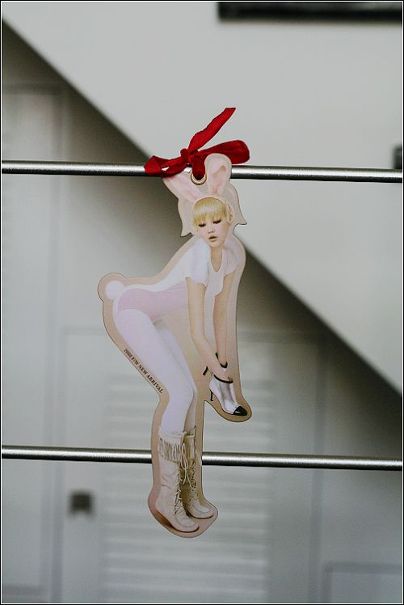

# 性感．午餐

一看就知道是[**陈曼作品**](http://blog.sina.com.cn/chenman)，不由对what for制鞋公司产生些许好印象，花钱把艺术创作用在商品包装上，的确为提升品牌形象加了分。这样的性感卡片，不知道成本是多少？所以没舍得将这个性感女郎随同鞋盒一起扔掉。  
  
  
  
停电，电饭煲没法用。  
午餐只能吃方便面，加两只营养鸡蛋。  
  

---

## 评论（6）

**[理肤泉](http://www.elifuquan.cn)** · 2009-03-24

方便面没啥营养，少吃为妙~~

**大姜炖去** · 2009-03-24

好久没吃 康师傅了

**蚊子** · 2009-03-24

那个可以吃味千的方便面，还不错

**Michael** · 2009-03-25

快餐面我还是喜欢8角一袋的.

**Christina** · 2009-03-25

8角一袋的是什么方便面？

**mandy** · 2009-03-26

8角一袋的是不是中萃食品厂的鲜辣方便面？还有雪菜肉丝好象也是~~

