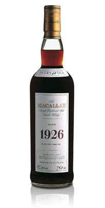

# Macallan Fine&Rare 1926

吴宗宪《我猜我猜我猜猜猜》2009春节前那期，介绍了一瓶非常贵的威士忌酒：Macallan Fine&Rare 1926，据说世界上只有38瓶这款酒，每瓶的价格为360万台币，由38人分别购买收藏，其中只有两人开瓶，大多数人均以收藏为主。2002年在英国举行的一次拍卖会上，一瓶“Macallan 1926年”（1986年装瓶，60年酒龄），拍卖成交价高达20150英镑，折合人民币达到30万元，突破全球威士忌单瓶拍卖历史最高价纪录。  
  
威士忌拍卖是一项新生的国际化活动，有人统计过，在全球威士忌拍卖市场上，麦卡伦占拍卖成交总价值的21%，已成为全球威士忌收藏家的首选投资品牌。要投资，买Macallan威士忌吧！  
  
八卦完这篇惊叹酒价的blog，我也要看书睡觉去了。  
  

