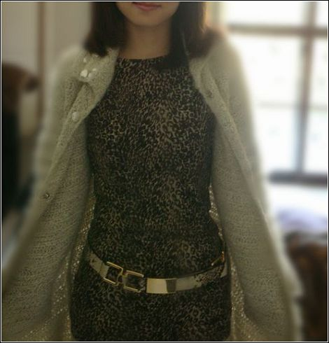
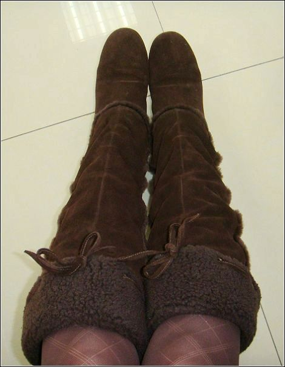
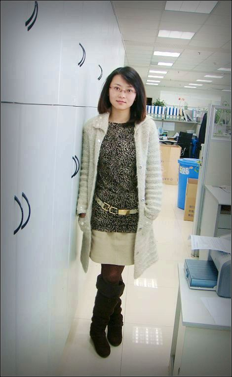

# 学习

下午党员开“深入学习实践科学发展观”的动员会，会议还没进行到一半，位子已经空了1/3。这就好象演戏和看戏的关系，演戏的一定得演，看戏的拿到票未必去看，也不会有什么约束和惩罚。当大人真是太好了，不去开会也没关系，小孩子一定不敢的。如果小孩子不去参加学校的会议，你会对他/她说什么呢？象《慢船去中国》里吓唬小孩子的话：“不听话，不听话就把你扔到国外的大街上去。”  
  
我一同事正在积极参加党外积极份子的培训，好象围城，进来之后或许也是面目全非？据说国资委统计今年第一季度出口下降50%，大家要捂紧钱包撑过这个冬天。可没见饭店和商场的人少多少，一点看不出危机四伏的状况，难道这些人头攒动的都是公务员？每次开会都觉得台上的人...挺累的，而往常那个愤怒的小青年修炼成“酒肉穿肠过，佛祖心中留”？我居然坚持听完发言，还能保持平静、不烦躁，心里的那盆水任谁来搅一搅都可以，渣滓总要沉淀在盆底的，休息，休息一会儿好了。  
  
弄了件豹纹衫穿，尝试一下。  
这张有点“兑奶风”的效果了吧？  
   
  
毛靴子呼应一下毛茸茸的长毛衣。  
   
  
狭长的办公室走道也许可以提供干净的背景。  

---

## 评论（11）

**lilian** · 2009-03-25

是发型变了还是拍摄角度的问题,脸型有点显胖哎.

**Christina** · 2009-03-25

头发披下来，脸型是显得胖呀~

**rebecca** · 2009-03-25

一如既往还是很美丽的！

**[realqi](http://www.realqi.cn)** · 2009-03-25

MM 好漂亮哟，不知道MM的blog主机是怎么弄的，  
好想了解一下，不知道MM方不方便给个email呢？  
heiheijian@hotmail.com

**农妇某人** · 2009-03-25

只要不发言不要汇报思想（不然我肯定逃掉），开这样的会我也能坐得住：画小人儿看闲书发短信。。。嘿嘿。  
人瘦怎么穿都好看。你怎么就可以敞着吃不担心发胖呢???

**蚊问问** · 2009-03-25

话说这小腰真细捏

**邃** · 2009-03-25

我还是觉得黑色的衣服能衬出你的气质，不过，身材好，穿衣服就可以随心所欲，大胆尝试各种风格的衣服。

**Christina** · 2009-03-25

哈哈哈哈~我今天就是画小人度过党员会议的：D

**Michael** · 2009-03-26

豹纹的：）一个字美!

**[quinn](http://simplenice.wordpress.com.cn)** · 2009-03-26

你是党员？！！！ 无限惊讶  
呵，是否你每月还要过党的组织生活啊？  
那真是件痛苦的事情

**bing** · 2009-03-27

很像那个谁 孙俪

