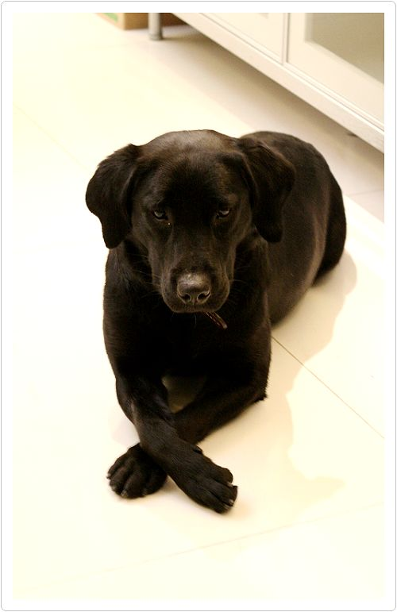
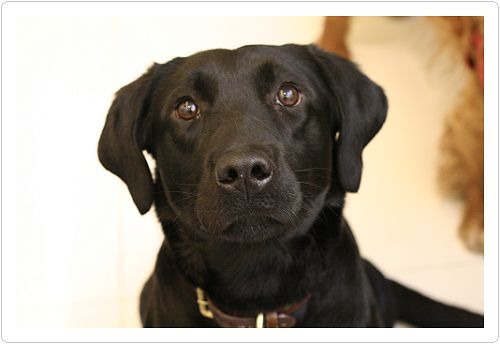
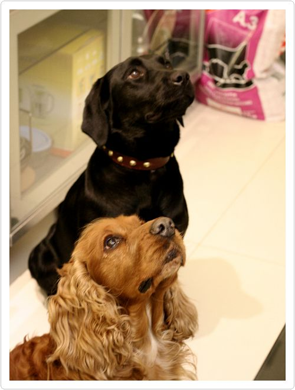

# 小二黑做客

她又来我家做客了，恰好炖了猪手黄豆汤，可以分享给两个小家伙吃。那么渴望的眼神，完全出自对美食的期待。小黑每次来会毫不客气喝光LUKE的水、吃光LUKE的狗粮。这一次乖乖的坐在厨房里看我忙碌的洗菜烧菜，孩子稚气的表情，让人怜爱。  
  
从前羡慕别人养大狗，曾梦想以后有条大狗陪伴，可是从小黑来做客几次之后忽然觉悟：养大狗不是轻松的事儿。她的尾巴来回摇摆，打在家具上噼里啪啦地响，打在人的腿上也一定不是鹅毛拂过的感觉。大狗喝完水滴在地上的面积一定比小狗大，如果它还很调皮的话，你的噩梦这就上演了。所以，地方不够宽敞，手头不够宽裕，精力不够充沛，想都别想，还是养小狗狗吧！  
  
水足饭饱来个芭蕾交叉手位，每每都是这样优雅：）  
与她在家里便便的行为相比实在是让人大跌眼镜。  
  
  
这面孔怎么看也不象一位MISS，还是我家妞妞长的纤巧。  
这副傻呼呼的样子，吃起东西来可是很细作的哦，抿着小嘴在你手掌里吃东西，怪痒痒的。  
  
  
LUKE反应总是没有拉多快，即使这般警惕地盯着食物，也一定是小黑抢到嘴巴里的。  
   
  
\*\*今天食欲不好，眼睛有点疼；  
\*\*从卓越上定购4本书，太想接着看“简妮”了，上次定书卓越网居然没货，当当的网速慢到无期限地等待。这4本书也许下周一才能到，期待ing~两周半时间看完两本书，速度挺快吧？洗完热水澡、睡觉之前，是被窝里幸福的读书时光；  
\*\*咖啡色皮衣+米白色羊毛裙+咖啡长袜+咖啡色长靴，因为那一片米白色似乎有点奶油巧克力的效果？从前排斥咖啡色，年纪大了却渐渐对这个色系有了好感；  
\*\*洗头后的第二天，头发才服帖些，看来得将洗发安排在晚上，睡一觉头发就不会“轻舞飞扬”了。  
   

---

## 评论（12）

**jiajialing** · 2009-03-26

小黑很帅， 最后一张抓的好！

**Christina** · 2009-03-26

人家是女孩子哦~是帅还是漂亮呢？

**lilian** · 2009-03-26

我想怎么搭配这么浅色的裙子呢，原来是羊毛质地的呀~

**lilian** · 2009-03-26

生活越忙碌，心态越浮躁，在当当上买了一堆书竟然一本都看不进去。唯一看完的那本《我爱问连岳》，还是去年买的。

**Christina** · 2009-03-26

有一天会看进去的：D

羊毛裙细节：

**哦也** · 2009-03-26

袜子  
好美

**enriquesun** · 2009-03-26

袜子好性感  
O(∩\_∩)O哈哈~

**mandy** · 2009-03-26

美女别咬嘴，这样就不美了~~小二黑和LUKE我很喜欢。最近经常会给院子里的流浪狗-花花喂食~~同事夸我很有爱心：）

**农妇某人** · 2009-03-26

《慢船去中国》我觉得是陈丹燕的作品里面人性挖得很深刻、很锋利、非常不留情面的一本，用她很细腻的观察和文字。特别是关于范妮。可能跟我们的年龄还有生活时代很贴近的缘故吧……我挺喜欢的。

**大姜炖去** · 2009-03-26

小黑看起来倒像是boy，luke为什么眼中常含着泪水  
呵呵，难道是因为他爱食物爱的深沉

**guoke** · 2009-03-26

仰慕好久了

**Christina** · 2009-03-29

人性挖得很深刻、很锋利、非常不留情面的一本….  
的确是非常不留情面，今天开始阅读“简妮”，不晓得会不会有“范妮”精彩？

