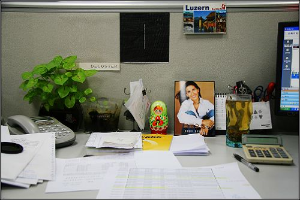
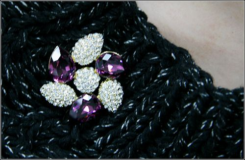

# 拉着阴霾脸的天气

拿了研发的相机拍的，这不是和女邻居用的Canon 30D一个型号么？是不是和俺的350D有区别呢？区别肯定有，但这张相片上没看出来~一个套头下的周末办公桌，透着轻松不了的气氛，拉着阴霾脸的天气，让人高兴不起来啊~办公桌的正面尚算整洁，侧面......就不说了。  
  
有个朋友刚买了5D，给我看5D拍的人像，效果...那真是...跨...时代的飞跃，不晓得这次飞跃是相机原因，还是他的水平提高了？亦或是相片里的神仙MM太脱俗了？有人说借他的5D玩玩呀，我就不愿借，坏了怎么办？可有人恰恰相反，说用借来的高档镜头不心疼。原来人类是这样思考滴？我说相机怎么好意思借别人的呢，言下之意是想说等将来某一天我真的换了无敌兔，你们谁也别向我开口啊。  
  
   
  
春节买给自己的礼物，一颗胸针。  
  

---

## 评论（7）

**cecile** · 2009-03-27

这个胸针真好看！

**绿恐龙** · 2009-03-27

思前想后 无敌兔除了带自动清洁功能好一点外，bug太多了。。哎。。

**Christina** · 2009-03-27

有了无敌兔，应该无所求了吧，呵呵~  
350D还要再折腾一段时间呢，你说无敌兔会降到1.1万吗？

**大姜炖去** · 2009-03-27

1.1……

**Sherry** · 2009-03-27

哈哈，换无敌兔吧~~

**流星** · 2009-03-28

页首那张蔷薇花很漂亮，色调很美。  
当然人也漂亮。

顺着光光那里的链接流窜过来的。

**Faye** · 2009-03-31

看得晚了，好像删掉了几张图

