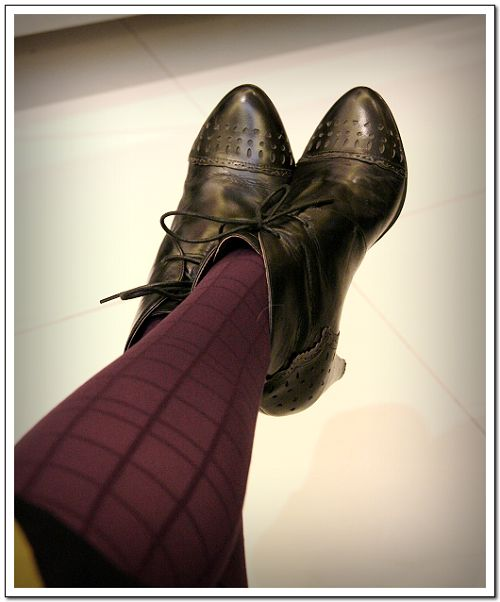

# 有意思

睡到下午三点才起床，躺被窝里看了两部碟：[**《007系列22 Quantum of Solace 》**](http://www.insun.com.cn/Html/dyfxb/audience/comment/242426056.html)和[**《Seven pound》**](http://www.mtime.com/movie/71879/)。哎呀，第二部让我抱着枕头哭地淅沥哗啦，不划算。Will smith怎么老演善良到极致的角色呢？作者说他参加party时遇到一个年轻人，表情非常悲伤，有很重的心事似的。和这个人聊到半夜，原来他遭遇一次车祸，死了7个人。回到家作者就想这是一个很好的题材，可以写成剧本。于是这部《Seven pound》就诞生了。感觉这部片子在教授自杀的人在自杀前捐献自己的器官给仍然想要生存下去的good people。我想我要是患了绝症，也捐献器官给需要的人，然后将骨灰抛洒在江河湖海，绝不在这世上占用一块土地...那么，现在除了听天由命还要尽量快乐地活着...不好，暴露故事情节看起来就不好玩了。这是感动之一；  
  
有意思之二是每周五晚上7点多钟湖南卫视节目“天天向上”，特别好看。连续看了三周。这周选了若干北大外语女生和复旦诗社男生，归归，90后的男生女生比俺们20岁时出趟多了。当诗社男生对自己选择的北大某女生朗读名人诗词时，我浑身的毛孔象花一样绽放，有几次甚至红了眼圈....这昔日黄花也会被打动的啊，更别说那些青涩懵懂的小女生了。里面那个小主持人“欧弟”很讨喜，讨厌汪涵被众星捧月般地每每出来主持，搞得跟江湖黑社会老大似的。  
  
有意思之三：3点起床，4点接到确认参加婚礼的电话，这已经是第二次确认是否可以在6点前到达婚礼现场。无形的压力让我出了门就拼命开，天晓得居然绕了很多路才到，连红包上都没来得及写上祝福（我是不是要告诉新郎我送了多少礼金呢？）。又一个巨大婚礼，好象有4、50桌宾客，看着当年进公司的阳光帅哥30岁后终于不再孤单，且在婚礼上何止是兴奋，简直就是亢奋....悲欢离合终有期，总有属于他的幸福到来。在他极具责任感的肩膀上又担负起一个新家庭，他的母亲、他的妹妹和他的新娘。  
  
本打算穿这件中袖毛衣去参加婚礼，却被这副手套的质感cancel掉了。  
  
  
最终决定复古一把，选择了蝙蝠袖、塌肩的黑色薄毛衣+羊毛蓬蓬裙+立领肩章式修身短羊毛大衣。头发两天没洗，不蓬松啊？托人在纽约买的Coach项链，最近尤其喜欢金色饰品。  
  
  
复古风的格子丝袜和高跟鞋。在上海时遇到一双灿黄的长统袜，很喜欢，可那是最后一双样品，没买。如果今天换成灿黄的样品袜，可能效果更好些？  
  
  
打包了婚宴上剩下的羊肉棒给LUKE，安抚一下他独自在家的小心灵。  
   

---

## 评论（9）

**Maggie** · 2009-03-28

沙发！这条裙子真是太有味道了。不知平时都在哪里寻到这些宝贝

**bshawk** · 2009-03-29

非常不错，抢个板凳坐坐下慢慢看！

**大姜炖去** · 2009-03-29

赞一下这条裙子

**蚊问问** · 2009-03-29

你这是开去哪里参加阿？ 把我们的可怜的LUKE一人丢家里。。。早知道接来我家玩

**邃** · 2009-03-29

裙子真挺不错的，配黑色的上衣效果就出来了。  
去参加婚礼的人心情不错，呵呵。  
能够真诚的去赞美90后，我很欣赏。我是80后，但是我觉得其实处于那个时代不是最重要的，重要的是以什么样的心态去看待自己和客观的去看待这个社会。

**[理肤泉](http://www.elifuquan.cn)** · 2009-03-29

都爱好，主人更美~~

**firestone** · 2009-03-31

一直想养个狗给孩子玩，美国几乎家家都养狗，可是华人中养狗的很少，我挺喜欢小狗，真佩服老美一家四五条狗，还有3-4只猫，还有小BABY。

**Christina** · 2009-03-31

faint！那家里肯定得有个留守的，不然怎么照顾一屋子的生物呢？

**firestone** · 2009-03-31

两人都上班，一人7-3：30，一人4pm-12pm，家里没人狗在院子里跑，院子有FENCE。

