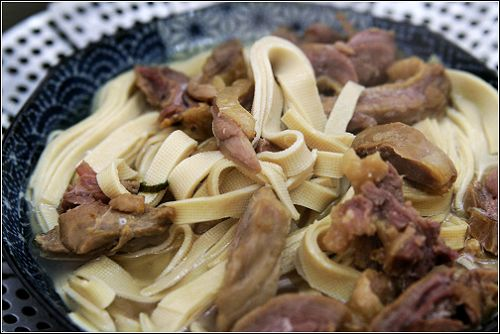
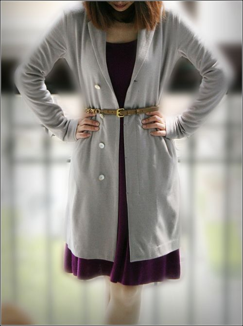

# 星期一

恋人就象孩子，越被管教，越会撒谎。  
越限制......越显露自己不自信。  
越被粉饰的越具有一定的虚假性。  
  
中午的千张条炖咸鸡腿肉。  
注意！主要是盛菜的碗。  
   
  
周末两天过得真是混沌，啥事没干一晃眼就过去了。星期一的早晨睡眼惺忪爬起来上班，对的，天气一下子又开朗了，只穿了羊毛裙＋长针织外套，不穿大衣也能出门。  
下午，又是会议........  

---

## 评论（11）

**Maggie** · 2009-03-30

还是我沙发！惊蛰之后，楼主好勤快。也许这些新衣服老早就置办了，只等天暖主人心情好时出动呢。真是赏心悦目。

**Christina** · 2009-03-30

Maggie有msn吗？衣服有些年头了。

**Sherry** · 2009-03-30

天天都很PP啊~~

**Christina** · 2009-03-30

主要是心情，心情，嘿嘿~

**邃** · 2009-03-30

呵呵,我也觉得“茶“最近心情不错,笑容看上去就不一样,春天真的是万物复苏的吗,连心情也是

**大姜炖去** · 2009-03-30

春寒料峭，注意保暖，腿不要着凉了  
呵呵，看来茶姐心情很好

**sususu** · 2009-03-31

我觉得茶把紫色穿的很好看  
茶是不是特别喜欢紫色啊 这个博客的背景也是紫的  
特别幽雅的感觉

**Christina** · 2009-03-31

其实最喜欢黑色。

**Vodka** · 2009-03-31

您的品味不如以前了。

**Christina** · 2009-03-31

太好了，我就不喜欢以前：D

**[薇安](http://bulaoge.com/?vivianxu)** · 2009-04-01

今年喜欢紫色人好多啊，而我一直喜欢。不过购买很谨慎

