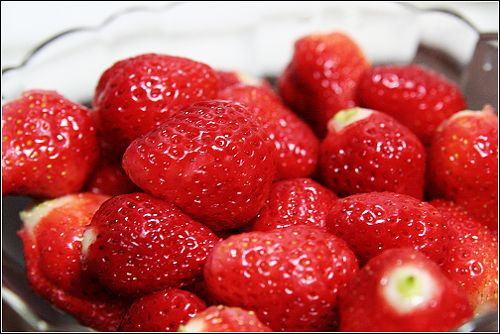
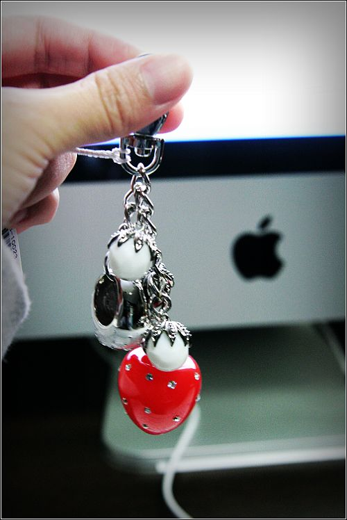

# 草莓．新鲜

晚上到姐姐家拿药和蔬菜，回到家才发现比自己列出的蔬菜还多出好几种，有姐姐真好：）晚饭打包了马台街的老头盖浇饭，吃得那个饱啊，数了下“盖浇”有六种搭配：芹菜、包菜、胡萝卜、豆腐干、皮肚、猪肝，琢磨着什么时候自己也做一次试试。  
  
老远看到姐姐坐在水果摊上挑东西，这些小小的草莓比大个头的草莓要好吃一百倍，尤其是姐姐亲手挑拣的。姐姐象妈妈却超越妈妈对我生活的细心关照，婆婆妈妈有什么不好？生活不就是这样婆婆妈妈才过得细致么？心情象这盆草莓一般新鲜水灵在泛着淡淡春天气息的夜晚。要是我以前也能这般体会生活就好了~  
   
   
  
MOS的挂件，还崭新的摆放在首饰包里。  
上面也有一颗漂亮的草莓。  

---

## 评论（9）

**Maggie** · 2009-03-31

千万不要去傅家边之类的草莓基地买，大棚里的都不甜，光是个大。倒是菜场或水果店的地道些，有草莓味儿。春天的饭桌上，无论什么饭菜，加上一盘芦蒿，一个草莓果盘，顿时生动起来。

**邃** · 2009-03-31

有个姐姐真幸福！

**sususu** · 2009-03-31

我就是没耐心去挑草莓，就偷懒直接买水果店摆出来的一小篮。这草莓真水灵啊，你都怎么洗草莓啊，我就是泡几个小时。

**Christina** · 2009-03-31

嘿嘿~我用盐水泡草莓，然后用自来水冲洗，最后用凉白开过一浇，这样科学吗？

**itsmin** · 2009-03-31

这种方法很科学。。。鉴定完毕。哈哈。

**大姜炖去** · 2009-03-31

像是吃菠萝的方法  
呵呵

**mandy** · 2009-03-31

生活不就是这样婆婆妈妈才过得细致~我也是老了才懂得体会~

**firestone** · 2009-03-31

在国外生活的华人才是心境如水，生孩子养孩子教育孩子，种花种菜，工作养家。

**Christina** · 2009-03-31

所以你们都奔国外了，我们留下来时不时追求一下“心境如水”，可贵啊~

