# 金陵花事

Sherry上周末外出拍海棠和樱花，发来几张给我看。女性拍的PP和男性还是有区别的，非常甜美素雅，为她突飞猛进的摄影惊喜。  
  
很喜欢她在莫愁湖公园拍的第一张“水边的垂丝海棠”，似清新水墨画，好象一碰触那些色彩就会融化了，春天在心里轻轻地挠着痒痒，怎能让人不动心？据说海棠花是一棵一棵的树哦，我以为是种在花盆里一小棵的呢。Sherry准备把南京一年四季的花卉都记录下来，做一个“金陵花事”的集锦。  
  
这些被拍烂了的景色，仍然有动人之处，关键还是相机后面的眼睛。  
  
**Sony @200  
Shot by Sherry**  
  
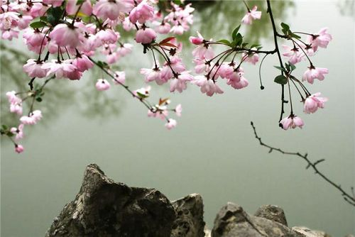   
  
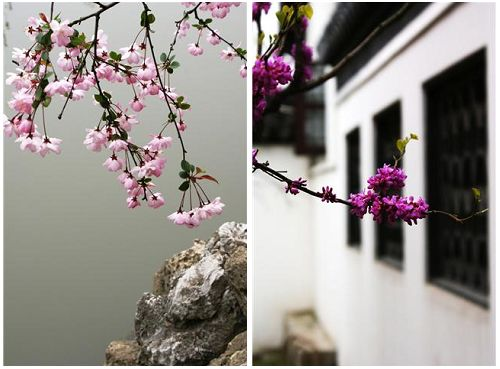   
  
樱花就没那么好拍了，拍一朵海棠花还可以看细节，一朵樱花就不好看了。  
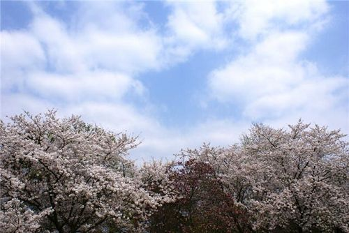  
  
\*彩云之南\*  
Sherry拍摄于2009年春节  
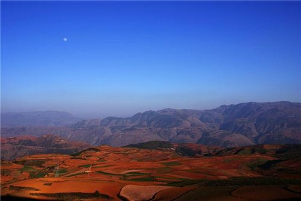   
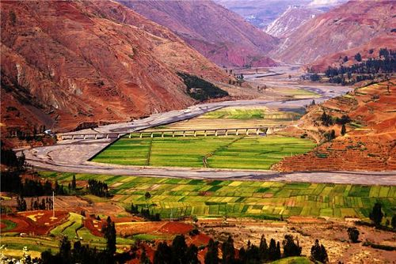   
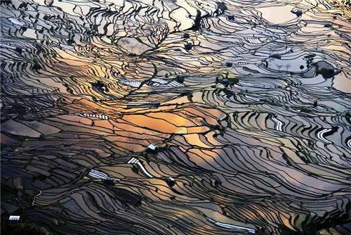   
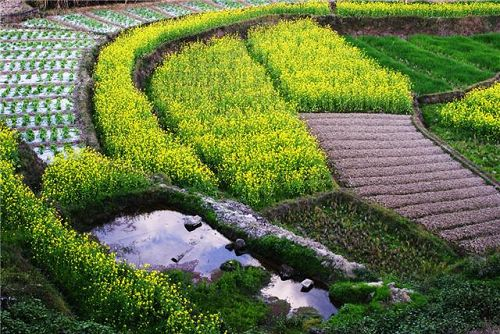   
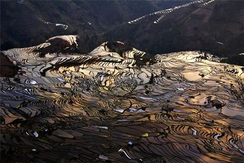   
  
还是一点没变，和她拍的PP一样甜美。  
Sherry于2008.11.  
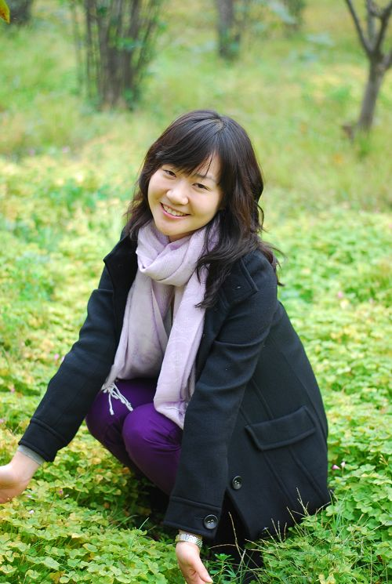  
  
我有两个笑靥如花的女友，为她们拍照总是赏心悦目。   
\*\*\* [**2005年5月拍摄于南京**](http://photo.lifetea.org/v/my+friends/200405angie/?g2_page=1)  
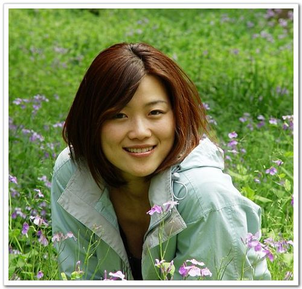  
  
\*\*\* [**2006年冬天拍摄于南京东郊**](http://photo.lifetea.org/v/my+friends/06sherry/?g2_statusId=x818a0e79&g2_navId=x5ec2feba)  
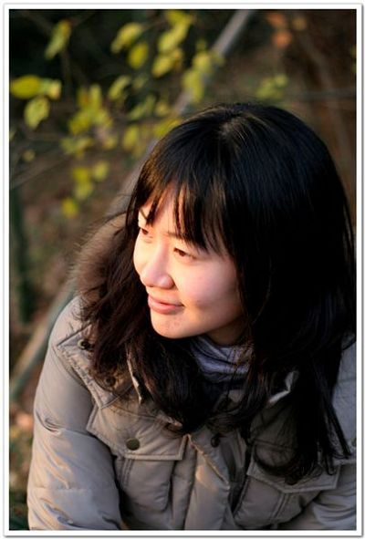

---

## 评论（15）

**nana** · 2009-04-01

sherry拍的很美。  
关键还是相机后面的眼睛。—恩，我也这么觉得。

**itsmin** · 2009-04-01

真有种水墨画的感觉，尤其是第一张。赞！

**鸟人** · 2009-04-01

好想出远门

**大姜炖去** · 2009-04-01

BBC拍的美丽中国中我印象最深刻的就是这些梯田  
sherry拍得真美  
比较喜欢彩云之南中的第一张和第三张

**anonymous** · 2009-04-01

非常漂亮的照片。不过最喜欢的还是最后一张，Sherry还是那么甜美，不过，看起来却越来越年轻了。。。

**zyz** · 2009-04-01

赞～～

**Maggie** · 2009-04-01

元阳真的精彩，可惜当年去的时候季节不对，只有一种绿色，没有层次。

**流星** · 2009-04-01

有的东西的确不适合拍照，樱花就是。樱花的美不仅仅是花，还在于樱花营造的气氛，那种花瓣随风飘零的气氛，才让樱花与众不同。

梯田是适合拍照的，点，线，面，色彩，传统审美的元素，可以精致地组合进一个画面。

**Ivy** · 2009-04-02

Sherry那组彩云之南是哪拍的？ 构图很不错。

**Sherry** · 2009-04-02

谢谢大家捧场啊~~更有动力啦！^\_^  
Ivy, 彩云之南拍的是云南东川红土地，元阳梯田，和腾冲路边的油菜花。

**[joanna](http://yanmer.cn/blog)** · 2009-04-02

你们几个好友都没变，反而越来越年轻，真棒！sherry的片子进步得让我……哈^o^

**Michael** · 2009-04-02

航拍?

**[清雅茶事](http://blog.sina.com.cn/chinatea)** · 2009-04-03

心醉一般的美丽 景  
融化一样的甜美 人

**jiajialing** · 2009-04-03

kao，来晚了。。。赞一个美女！有潜质。。。。

**[少爷](http://jennyshaoye.blogbus.com/)** · 2009-04-05

不错,真是美人美景

