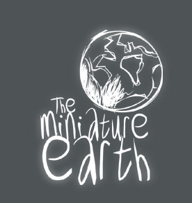

# The miniature earth.

The idea of reducing the world’s population to a community of only 100 people is very useful and important. It makes us easily understand the differences in the world.  
There are many types of reports that use the Earth’s population reduced to 100 people, especially in the Internet. Ideas like this should be more often shared, especially nowadays when the world seems to be in need of dialogue and understanding among different cultures, in a way that it has never been before.  
  
click here:[**The miniature earth**](http://www.miniature-earth.com/me_english.htm)  
Thanks to Min.  
  

---

## 评论（2）

**itsmin** · 2009-04-09

我们的需求，欲望总是这么的多，以至于忘记了许多基本的事实。  
像这样的东东，分享，传播出来才有意义。谢谢。

**Christina** · 2009-04-09

对这些有思考的总是少部分国人，也许大众还不富裕吧，社会福利保障还不完善…….我们还太浮躁。

