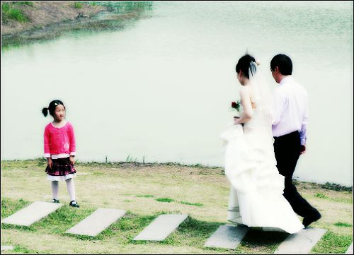

# 琵琶湖：浓墨重彩的烂漫

在琵琶湖边坐下，拍照变成守株待兔，两个小时内来回10对新人，不是拍婚纱照就是婚礼当天拍外景的。  
  
记得曾经看到一篇文章，大概意思可以用电影版《欲望都市》里Carrie的婚礼说明，Carrie之前筹划了一个200宾客的庞大婚礼，吓跑了Mr.Big.............最终以只有他们两人参与的婚礼结束，文章最后一句“爱情何需众人见证”。非常私人化的关系越粉饰越具有一定虚假性？以及今天这种浓墨重彩的烂漫，所谓内里无所附着才需要依靠一些外在的支撑。大家的婚礼一样，连写真上新娘被柔化后的脸都是一样的。当然生活永远需要形式这个东西，可是能不能让我们多点属于自己的特别和新意？  
  
推荐一个fotoblog[**“Something in Blue”**](http://www.sibblog.com/)，这是在纽约专门帮新人拍摄结婚照片的网站，上面展示的相片还能让人体会到一些真实的烂漫吧？  
  

---

## 评论（1）

**[Sunflower](http://chinesefood-pictures.com)** · 2009-04-19

Such a nice blog, Nanjing is a very nice city in spring!

