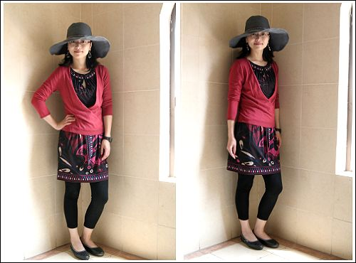

# 春季的下雨天

郊游完南京便下雨了，温度并没降，潮湿的空气中有着春天淡淡的暖意却仍然有着几分清凉。雨水洗刷了郁郁葱葱的植物、空气中的污浊以及建筑上的灰尘，好象点了眼药水令人眼前一亮。这时候街上的人总比平时要少，最爱这样的街道，也爱春季的下雨天。  
  
这两天感到疲劳，从小腿肚子开始延伸到全身的拖沓。菜懒得摘，饭懒得吃，最好天天吃零食啃鸭掌吃水果喝咖啡....懒得写，懒得想，连八卦都看不懂了，完了完了，一次郊游就让我累成这样？春天来临前信誓旦旦要补回去年未完的旅行计划，这样怎么行呢？压根没走多少路呀？开车到琵琶湖，停好车下到湖边，坐在树荫下过了两三个小时而已。  
  
中午的太阳有点烤人，不得不戴上帽子去遛狗。天气凉爽时狗狗肯定走在人前面，不时要停下来等一等主人，天一热人走得飞快，而它的步伐开始变得缓慢。  

---

## 评论（8）

**lilian** · 2009-04-14

这周我在南京西路上买了顶帽子，被店员一夸，干脆就戴着走了，哈哈！

**Christina** · 2009-04-14

呵呵~那你肯定是最受欢迎的顾客~

**[joanna](http://yanmer.cn/blog)** · 2009-04-15

我也有一顶这样黑色的大檐帽^o^

**mandy** · 2009-04-15

呵呵~~怎么感觉戴眼镜戴帽子有点怪~~~

**蚊问问** · 2009-04-15

一样的， 外外根本就蹲在楼道里不愿扑向大好日光

**Christina** · 2009-04-15

这顶帽子是浅色藏青蓝的，好难形容的颜色。  
不戴眼镜就戴隐型，嫌麻烦，就中午遛狗那一会儿。  
LUKE无论刮风下雨还是出太阳，只要外出就很有兴趣。

**Sherry** · 2009-04-17

摆脱，表把自己穿的一截一截的。。。  
把打底裤脱了吧

**Christina** · 2009-04-17

冷哎~夏天就不穿打底裤啦~

