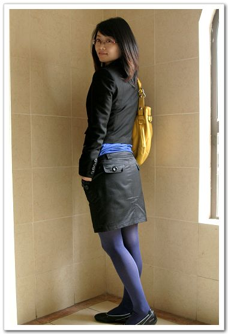
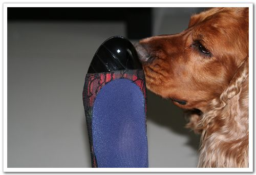
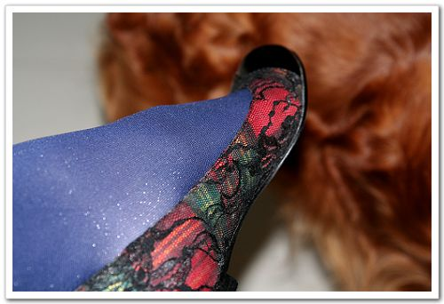

# 可耻吗？

打电话给姿儿，晚上快11点了她还在外面吃火锅，而我已经洗好澡吹干头发躺被窝里准备看书或者睡觉。  
  
“这段时间对我那些穿衣服相片烦感吗？”我问。  
姿儿：“不啊，玩呗，不过昨天那张有点象侏儒，怎么那么矮啊？”  
靠，我有那么矮吗.........  
  
总有一个声音不停地在心里对自己说：讲究吃穿是可耻的。思来想去那声音是从我小时候我父母那不厌其烦的教导声传到现在的回音。我们已经过了流行额外给完好的衣裤上打几个补丁的文革时期，能不能让人在条件允许的前提下稍微享受一下呢？这思想导致我稍微吃穿一下便开始自责，没完没了的禁锢，一边是禁锢一边是我那不屈不扰反叛的小心灵，还真闷呢~这一生究竟在什么时期可以放松心情的吃和穿呢？讲究吃穿真的那么可耻吗？  
  
   
   
   
  
不用担心，这是一双鞋底干净的鞋。不是舍不得穿，而是穿上它无法走很远的路，光滑的鞋底上面一点耐磨防滑的纹路也没有。只能上班穿穿，逛街穿是万万不行的，除非有一天变形了也许能穿上它想走多远就走多远。很喜欢这双鞋的做工和设计，外面是真丝的花朵图案被一层黑色花朵图案的蕾丝裹着，真丝和真皮拼接的鞋垫，那块真丝上也有着红色的花朵，与脚后跟接触的是一块磨砂皮。虽是一双平底鞋，但又不象现在商店里卖的那种“平感“，好象整个人是往后仰着。这双鞋跟着我也有三年多光景了。  
   

---

## 评论（18）

**Maggie** · 2009-04-16

这个心理活动非常有意思，快乐的猪，烦恼的人，烦恼的猪，快乐的人四种类型里，我们该站在哪个象限才是解脱呢？嘿嘿，今天的搭配很好啊，发型也有说不出的不同。中午看你七十二变是种休息，也是种乐趣。

**Michael** · 2009-04-16

这黄包蛮COOL的吗

**ware** · 2009-04-16

茶茶阿姨,你是用的dreamhost的空间吗,他们说不稳定,但我访问你的BLOG这么长时间了,没出过不能访问的问题, o o

**Christina** · 2009-04-16

哦？那他们骗小孩啊，真过分！  
Maggie，那相册里没见人影啊？

**蚊问问** · 2009-04-16

难道讲究不是热爱生活的表现吗？讲究是一种趣味啊。

**[一斤蓝色](http://hi.baidu.com/oneblue)** · 2009-04-16

蛮好！  
人生就是这样，吃吃穿穿拍拍，就老了。

**Christina** · 2009-04-16

哈哈~有人说你什么都好就是没有大志向….  
被这么一说，我倒真不知道什么是大志向了！

**lilian** · 2009-04-16

我觉得你的几个相框都配得挺好的，特别的简洁，尤其这个直角阴影立体感很强，哪儿能找着这类的素材啊。。。

**Christina** · 2009-04-16

光影上有的，下载就可以。

**mandy** · 2009-04-16

过分追求吃穿才是可耻滴~~~尽自己能力所及把自己打扮的漂亮一点不好吗？难道把自己捣持的灰头土脸才光荣？放松心情，愉快生~~~ 喜欢毛衣和彩袜的呼应~~喜欢你的叠穿，可是我不适合：（

**Cindy** · 2009-04-16

这双鞋子看起来有点儿像GUCCI的，呵呵。。。

**Michelle** · 2009-04-16

也许，当你不用讲究吃和穿也能自如享受放松心情的时候，就自然可以放松心情的吃和穿了。

**Christina** · 2009-04-16

这还真要追溯到儿童时期的经历，小时候父母总灌输什么是好什么是不好，长大了总会受到这种教育的影响。

**guangguang** · 2009-04-17

这个发型好。包也很好看。

**Christina** · 2009-04-17

难得看到你留言，欢迎光临，呵呵~

**Christina** · 2009-04-17

它，当然不是GUCCI哒~

**Sherry** · 2009-04-17

你这点小讲究跟可不可耻的不沾边啦~~

**aimda** · 2009-04-17

“捣持”应为“捯飭”daoshi,前两天才查的字典。

