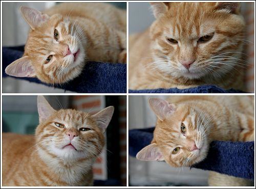
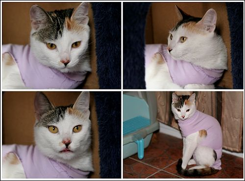

# 被割去的欲望

同一天，猫先生被割去睾丸，猫小姐被摘掉子宫。它们的游戏也失去了乐趣，从此只知道吃喝拉撒睡，身体会象气球一样吹起来。谁说真实不是游戏的部分？难道那份愉悦不真实？可是人类考虑的是如何避免欲望产生的结果...而已。  
  
不得不说猫眯的表情真的赋有表现力。  
奥特曼先生  
  
  
咪咪小姐  

---

## 评论（7）

**okdata** · 2009-04-20

哎，我们老头舍不得，结果每次打电话总听到那凄厉的惨叫，家里也怪味四溢。^\_^

**Christina** · 2009-04-20

如果异性猫眯同时在一家生活，你会让它们一直生育生育生育下去……….？

**golax** · 2009-04-21

人到了这个地步还有好说的呢？为了一己之私，可以做出这些残忍的事情，只是希望这个动物像宠物一样在身边，就因为它们有这些之用，还被人打着为它们好旗号做出这样事情，如果杀人对人有用，人们也会毫不犹豫的去发动战争践踏其他民族吧。当然两害相权取其轻，对动物残暴总好过对人的残忍，人总是自私自欲的。总算知道一点为什么日本有那些变态的罐头猫存在了。动物们还是在乡下稍微自在点，用不着刻意去溜被阉割，规矩秩序的城市里面压抑着多少变态的心理，然后这种心理有变成生活中的常态。难道大规模的城市化是人们不可避免的归宿？感叹一下，对事不对人。

**mandy** · 2009-04-21

为了利己~~无语

**[shenwen](http://shenwensw.blogbus.com/)** · 2009-04-21

利己？对于需要依赖人类才能幸福生活的猫，让它们无限发达地繁衍后代是什么结果？这不是濒危动物也。  
奥特曼先生和我收养的流浪猫一模一样。

**Sherry** · 2009-04-21

割了好，表象我家，一院子的猫。。  
这只黄咪，是我送你的那只么？

**golax** · 2009-04-21

并不是说不能割，我的意思是千万别说割了是为了狗猫们好，另外猫狗不需要人也能活，不管是家猫野狗。它们出现的比人类还早吧，不要把人的想法强加于它们。说到底这样做是为了自己耳根清净，以免后患无穷。

