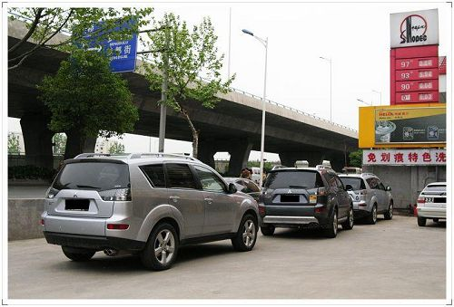
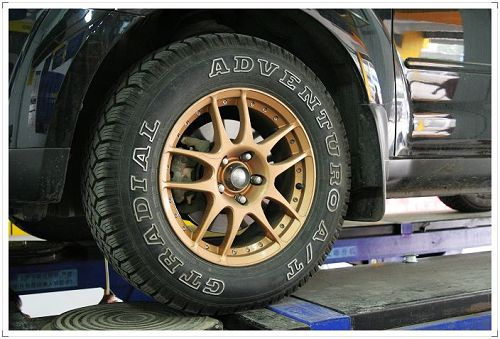
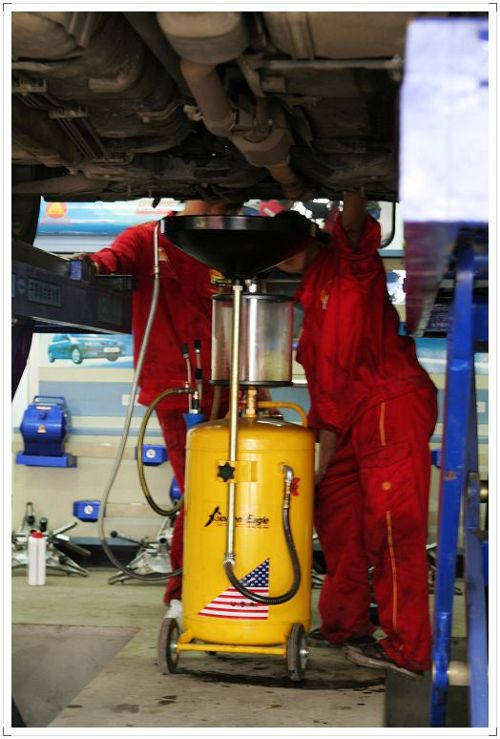
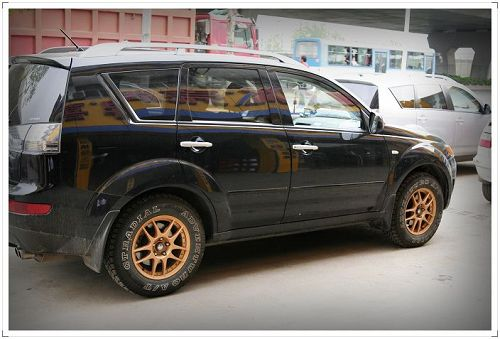
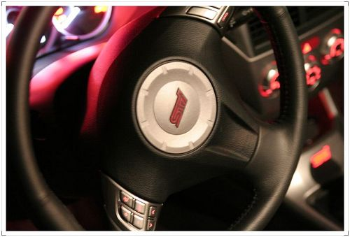
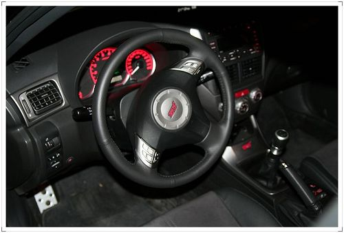
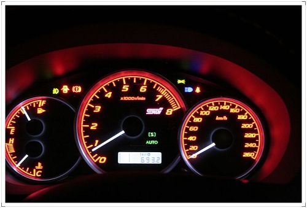
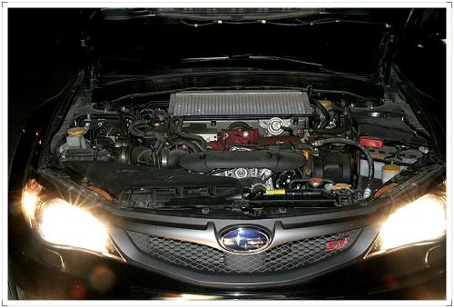
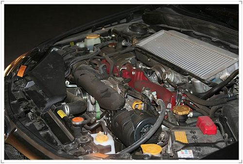
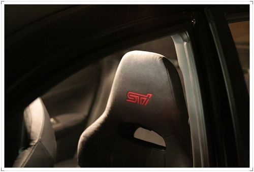

# 换油及STI

下午和另三辆准备去西藏的EX3.0在凤台南路更换齿轮油，当然我已经决定不去了。一辆车用不完一桶油，大家分摊着用就不会浪费了。其中一辆车更换成16寸轮毂和轮胎，金色轮毂配黑色车身有点STI加强版的风范。所有车处理完天色已黑，大家决定一起吃个饭再散伙儿。一路上四辆EX排队开过去，还真酷呢，开着开着我不禁幼稚地笑起来，跟小时侯春游时的心情差不多。  
   
   
   
  
  
因为4S店没有STI样车展示，这辆[**“SUBARU 08款（10代）STI标准版”**](http://data.auto.qq.com/car_models/8502/index.shtml)在我们晚饭后登场。它的主人是我好朋友的高中同学，与lulu熟识，还认识某班上的某某人，啊....这世界简直太小了！这车是他为自己30岁生日买的礼物，最近又看上[**INFINITI G37**](http://www.infiniti.com.cn/)（蛮懂车的），打算把这礼物以43万出售，才跑了5000公里。  
  
江湖上常有STI的传闻，300匹马力.....百万以内无敌，却有着朴实无华的外表。一朋友准备出手买[**09款 WRX STI 加强版**](http://car.auto.ifeng.com/lib/car/car.php?id=7231)了，那么，那么我就有机会“速度与激情”一把了！今年上海车展SUBARU出了[**森林人2.5XS**](http://www.car136.com/news/24/20090326/80978_p2.html)的新车，售价在26~28万之间，之前只有2.0和2.5T，这车会对EX 2.4冲击不小。  
  
曾试驾过新款森林人2.5T，与EX3.0比较配置没有EX丰富，音响效果不行（可以改装）。不过提速很快，过了2700转沃轮开始工作速度一下就上来了。而EX提速是一节一节的，相对比较安全，钻车流里的空档用SUBARU会很爽，森林人的空间不如EX大，比EX 3.0多10匹马力，如果你喜欢速度多于舒适的话可以选择这款车，但凡买SUBARU的人几乎都是冲着动力和四驱去的，现在买还有抽奖活动，中奖的人可以免费去北海道旅游，邬桑在当地陪你玩哦！另外，后驱车建议不要买，速度上来普通人操控有难度，尤其雨雪天气比较危险，容易出事。  
   
   
   
   
   

---

## 评论（5）

**ware** · 2009-04-22

请问茶阿姨为什么用textpattern，我觉得后台真难看

**Christina** · 2009-04-22

难看你就别用，这还不简单。

**Maggie** · 2009-04-22

我一度想换森林人，小T觉得这车咋样

**Christina** · 2009-04-22

不错，正好2.5XS出来了，价格也还合理。  
加10万块可以在EX3.0和森林人2.5T之间选择一款，性价比不错的车。但是EX 2.4就别考虑了，四缸，发动机和EX 3.0完全不一回事，虽然外壳一模一样。

**lusfe** · 2009-04-28

最近想换车，也在痛苦的抉择和不断的试驾中，唉

