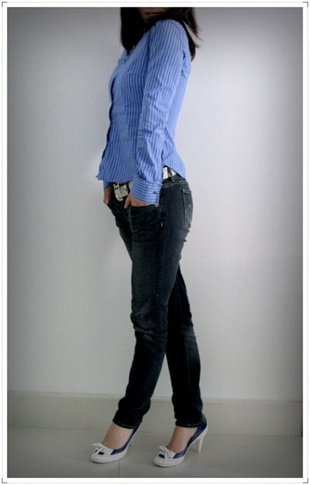
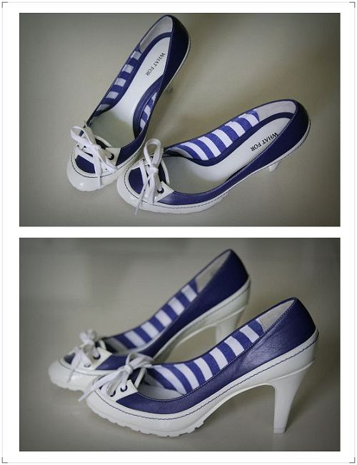

# 海军蓝

这鞋跟有5CM吗？那么今天我有1.7M高啦~也曾不适应穿高跟鞋，即使平跟鞋也有舒适与不舒适之分，重点是买到合适的鞋子，无论高跟还是平跟。想省心的时候就穿牛仔裤，随便配件上衣就好了。  
  
体检时医生说我左边甲状腺比右边稍微大点儿，昨天下午去医院拿了血化验和B超结果，没有任何问题，也就是说没有甲亢这一说。前几年有位同事被体检医生告知患有骨癌，吓死人家了，重新检查后压根没那么回事。我却不埋怨体检医生，至少重新细致的检查后令自己安心。看内分泌科的人还真多，那些个内分泌失调的人，表面看上去都是蛮健康的。  
  
其实最近都不在状态，白天面如菜色，因为天天晚上喝铁观音的结果。据说应该这样喝茶，袋泡茶泡一水就可以扔了，茶叶可以喝三水。天晓得在办公室里那茶叶喝过多少水才会换？也不知道为什么晚上回家还要继续喝茶？一日之计在于晨，如果我从早晨开始萎靡不醒，那么我的头发连同眼神都是耷拉枯燥的，可是到了晚上精神却越来越好。不是不懂晚睡等于慢性自杀，可得先戒掉晚上喝茶的习惯。  
  
   

---

## 评论（20）

**Vodka** · 2009-04-22

这种海军条纹我也很饭死~=)

**邃** · 2009-04-22

这双鞋子需要衣服来配的，如果配条白色的裙子会是什么效果呢，呵呵。

**Christina** · 2009-04-22

最好能找到酷酷的白色裙子来配，不太喜欢淑女效果。

**itsmin** · 2009-04-22

有点S哦，呵呵。

**Christina** · 2009-04-22

要是李宇春的“I”才流行呢，嘿嘿~

**itsmin** · 2009-04-22

是哦。感冒都流行的。

**蚊问问** · 2009-04-22

这个鞋满好看的亚

**Maggie** · 2009-04-22

这跟儿够高的。小T号称的没状态每天都不带重样儿的。要是这种“没状态”，我们也乐意接受。呵呵～

**Christina** · 2009-04-22

我晕，赶明儿我穿一麻袋配合一下没状态，如何？穿常规牛仔裤省去多少状态啊，你说是不是？休闲装就是省事装、没状态装：D

**[一鸣](http://blog.sina.com.cn/wwsyyc)** · 2009-04-22

气质与品位的完美结合，赏心悦目。

**firestone** · 2009-04-23

没胸没屁股，不太符合老外的审美观，老中好像只看脸蛋不看其他部位。

**Christina** · 2009-04-23

你是老外还是老中啊？你当这是A片展示场所？只要你太太有胸有屁股就好啦，呵呵~操心别人的胸和屁股，好奇怪啊~

**firestone** · 2009-04-23

什么是A片？？？

**Christina** · 2009-04-23

google啊！

**[joanna](http://yanmer.cn/blog)** · 2009-04-23

鞋真好看，就是担心出门转一圈，下边的白边是否灰头土脸？还是高跟更性感，就是架不住穿

**Maggie** · 2009-04-23

姓火的自重，不必这样炒作自己。

**Christina** · 2009-04-23

洋插队和老中的差异是：老中不晓得自信是建立在胸和屁股上的。学习啦~

**Christina** · 2009-04-23

高跟鞋偶尔穿穿就好了，指望它跟着你走所有的路，不现实哇~

**[shanshu](http://shanshu.blogbus.com/)** · 2009-04-23

喜欢。不过我不太会穿高跟鞋

**jeneffer77** · 2009-04-24

鞋子很好看啊，如果能配7分修身裤，或者热裤，就更漂漂拉。就是鞋口太浅了，走路会恨累得。

