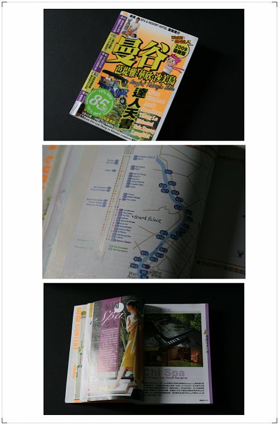
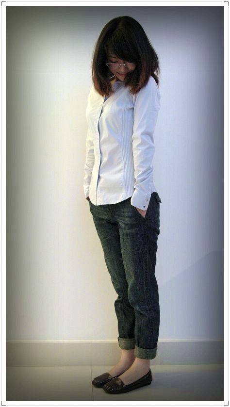
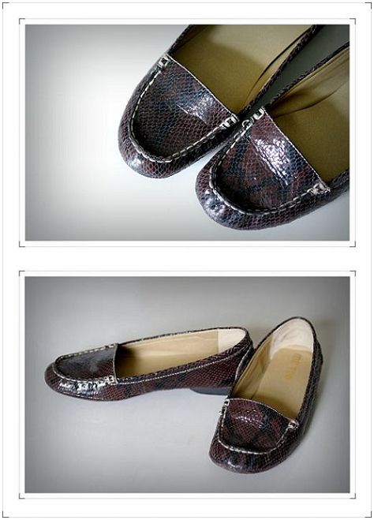

# ******左左人*

收到蔡蔡从深圳快递给我的泰国自助游手册，这姑娘才和朋友从苏梅岛自由行回来，据说假度的很开心。其实她完全没必要为我做这些，回想过去她洋洋洒洒写来的信透着与她年龄不相符的纯真（又一高龄的少女情怀），心里说不出的感动。再看看现在上窜下跳满脸无辜满肚子坏水的小P孩，简直无法想象他们发育的速度。  
   
  
蔡蔡在苏梅岛做SPA的地方，真想一头扎进画面里去。  
  
  
星期三，淡蓝色衬衫两侧是针织面料带收身效果的设计。5年前穿上它总感觉老气横秋，一旦自己老气横秋了之后这件衬衫却变得那么鲜嫩。换了合身牛仔裤和柔软的浅口鞋。  
   
   
  
在“shanshu”上看到一个[**有趣的测试**](http://shanshu.blogbus.com/index_2.html)，无论是拇指还是手臂看，我都是左脑使用者，即“左左人”。如坊间流传的那样，左脑擅长理性思维、计算、沟通和设计，右脑则是个梦想家，更为感性和情绪化，这叫做“大脑功能一侧化”。两个半球就像夫妻，通常一起对事情发表看法，可是有时也会配合不好，任由一方主导行为，像一个伪“裂脑人 ”。  
  
一百多年前，“杰基博士”诞生于英国作家斯蒂文森笔下，博士将药物注射进手臂，又变出一位“海德先生”，两个分身一善一恶，互相角力。这个《化身博士》的故事，显示同一个人可能拥有两种性格、两股意识，用后世心理学家创造的术语，叫“双重人格”。人格分裂症患者固然不常见，但你们看，很明显好多人伪装成那样子，白天不懂夜的黑，看起来很快活。  
  
那么“shanshu ”那句签名“做让别人喜欢的人....”太困难了，除非人格彻底分裂，再说讨好的人里面什么鸟都有，何必那么辛苦自己？该怎么着怎么着，年年岁岁，有人猝死，让咱善良地活在自然状态下别逼自己好吧？别人喜不喜欢你，真那么重要吗？不重要，真的不重要。只要你在乎的人喜欢你就行。推荐《YES MAN》看看吧。  
  
1.像祈祷一般，将双手交握起来... 看看你的双手   
左手拇指**被押**在右手拇指下的---------------------->左脑使用者   
右手拇指被押在左手拇指下的---------------------->右脑使用者   
  
2.将你的双手交叉环在胸前(揽住自己~~) 再看看你的双手   
右臂压住左手臂的------------------------------>左脑使用者   
左手臂压住右手臂的---------------------------->右脑使用者   
  
从1+2来看你的结果(要照1→2顺序看)   
  
右左人：善于体贴他人的传统温婉类型   
能直觉了解对方的心情，并自然和善对应的右左人。虽然无法主动积极的向前，但却会后退一步来迁就人，生性稳重且贴心，给人一股凡事都会好好照顾他人的安心感.不过一旦被拜托过一次，往后就很难再对他人说NO就是最大的缺点。不管自己有多么的痛苦也会为他人鞠躬尽瘁....这种热情堪称天下第一！  
  
右右人：最爱自己的挑战类型   
生性勇往直前，一旦认定〔就是这个！〕时就会马上采取行动！这就是好奇心旺盛最爱挑战的右右人。凭着一股气势就能够坦然挑战危险事物的鲁莽一族。但另一方面亦具有被抓住弱点时就很容易被打动的鲜细脆弱一面...。基本上，不听他人的话，会跳着听谈话的内容，也很容易就以主观意识说话。不过也因这般充满个性的缘故而备受众人喜爱，往往能成为人气者唷！   
  
左左人：认真又冷酷的完美主义者   
虽颇有女人(男人)味，但却是在这四种类型中最具有男子气概！凡事都能条理分明的理论性思考，会凭着一篇大道理迅速打败他。自尊心极高，正义感也比他人多上一倍。做为朋友是很值得信赖，但若与之为敌就会很棘手的类型。只不过，因生性认真又是完美主义者，常会让初次见面的人留下难以相处的不好印象。   
  
左右人：喜欢照顾人，领导型   
具有冷静的观察力能看透对方或现场的气氛，但亦具有能体贴入微照顾对方的一面，这就是兼具冷静与温情的左右人。因生性冷静，颇具男子气概且责任感强烈，像个大姐头般常会受到同性的爱慕。能自然聚集人群并与之俐落相处。只不过，有时也会忍不住太爱照顾他人。相当在意世人如何看待自己，总是保持警觉心。  
  
\*\*\*\*\*\*\*\*\*\*\*\*\*\*\*\*\*\*\*\*\*\*\*\*\*\*\*\*\*\*\*\*\*\*\*\*\*\*\*\*\*\*\*\*\*\*\*\*\*\*\*\*\*  
  
另一个有趣的测试：你是用左脑，还是右脑？我看了10秒钟这个舞女就开始逆时针转了，然后我醒醒眼睛定睛再看又变成顺时针@\_@，10秒后继续逆时针......左右脑在打架吗？  
   
  
如果你看见这个舞女是顺时针转，说明你用的是右脑，如果是逆时针转，用的是左脑。耶鲁大学耗时5年的研究成果，据说14%的美国人可以两个方向都能看见。  
  
右半脑发达的人：知觉、想像力、空间感和把握全局的能力都有可能更强一些。在各种动作上相对更敏捷一些。右脑最重要的贡献是创造性思维，不拘泥于局部分析，而是统观全局，以大胆猜测跳跃式地前进达到直觉的结论。在有些人身上，直觉思维甚至变成一种先知能力，使他们能预知未来的变化，事先做出重大决策。  
  
左脑的记忆回路是低速记忆，而右脑的是高速记忆，左脑记忆是一种“劣根记忆”，右脑记忆则让人惊叹，它有“过目不忘”的本事。  
  
左脑发达的人：处理事情有逻辑、条理。社交场合活跃，善于判断各种关系和因果，善于统计、组织且方向感强。左脑发达善于做技术类、抽象的工作（如电脑编程）。   
  
男性是根据右脑和左脑各自不同的分工来使用大脑的。相比之下，女性却可以同时使用左脑和右脑。男性和女性大脑的最大区别主要是大脑皮层的构造不同，女性大脑的沟通交流能力特别发达，她们细致、敏感，能够通过察言观色来了解对方的心理，直觉也很灵敏。从构造上看，女性左右脑的脑梁部分粗于男性，因此左右脑可以顺利地同时使用。多数男性方向感天生就比女性强。

---

## 评论（14）

**邃** · 2009-04-23

呵呵，我也在深圳。这里加速女人的发育，衰老，迟钝。唯一的好处就是可以自由自在，更甚至疯狂的驴走。这说的什么啊，呵呵。如果你要是来深圳玩，一定提前留言，保准在这里能受到热烈的回应。

**Christina** · 2009-04-23

“亦具有被抓住弱点时就很容易被打动的鲜细脆弱一面…”（坏笑ing……）

楼上的可以参加超女超男选秀活动哎~“因这般充满个性的缘故而备受众人喜爱，往往能成为人气者唷！”

**Vodka** · 2009-04-23

嗯哼，建议christina把近期照片结集为《最是那一低头的温柔》~

**[一斤蓝色](http://hi.baidu.com/oneblue)** · 2009-04-23

大资生活~

**[一斤蓝色](http://hi.baidu.com/oneblue)** · 2009-04-23

所以咱拍点儿照片自我安慰咯，大资问你爱看不爱看呢？

~~~~~~~~~~~~~~~~~~~~~~~~~

简称自慰？呵呵！

很爱看，天天来报到！只是一般来去匆匆，无暇留下爪印。  
有一点我很好奇，女孩子是不是都衣柜大过书柜？：）

**[一斤蓝色](http://hi.baidu.com/oneblue)** · 2009-04-23

仔细对比一下，发现女孩子穿高跟后 S 形的角度确实有区别！

**候鸟** · 2009-04-23

我是右左人。

鞋子是蛇皮的吗？

**Christina** · 2009-04-23

一斤蓝色，你对比一下你妈妈的书橱和衣柜不就清楚了吗~呵呵~

**lilian** · 2009-04-23

竟然是右右人，可是第二个测试却是用左脑。

**Sherry** · 2009-04-23

活活，我是右右人，右脑发达。。

**Maggie** · 2009-04-24

左左茶，香港出的这本旅行手册很好用，上次去泰国旅行社的朋友就借的这系列的给我的。去香港除了买名牌外，一定要逛逛书店哟，会有意外收获的。

**大姜炖去** · 2009-04-24

最是那一低头的温柔，像一朵水莲花不胜凉风的娇羞  
道一声珍重，道一声珍重，  
那一声珍重里有甜蜜的忧愁—  
克里斯蒂娜！

呵呵，接5楼之言

**coco** · 2009-04-24

偶是左左人。

**CAICAI** · 2009-04-24

别感动了，只能说，认识你真好！

